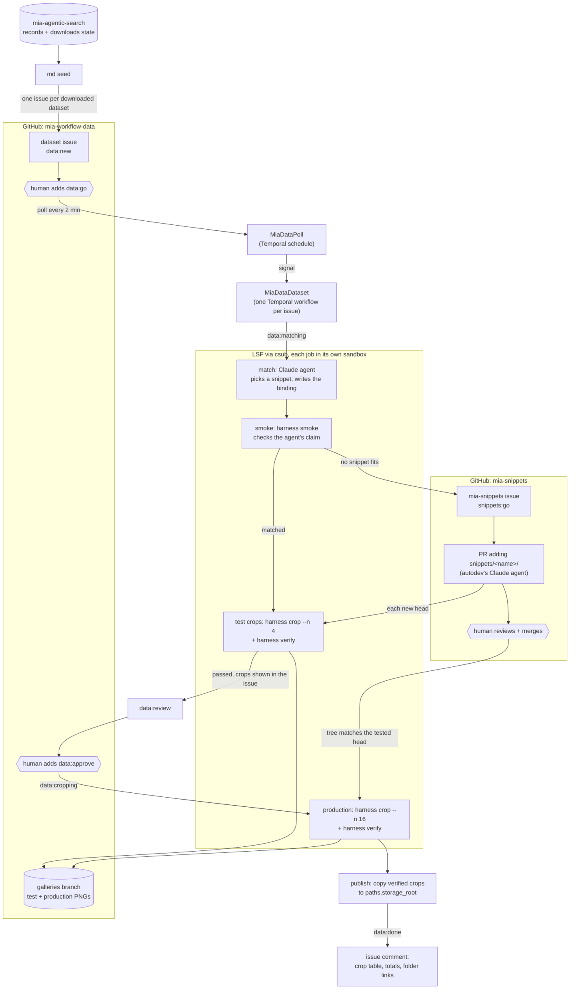

# The mia-data workflow

How a dataset in the MIA catalog becomes a set of verified, published image crops, and which component does
each step. The authoritative design is [`notes/mia-crops-spec.md`](../notes/mia-crops-spec.md); the setup
checklist is the mia-data section of [`notes/autodev-runbook.md`](../notes/autodev-runbook.md).



## Overview

Every dataset that [mia-agentic-search](https://github.com/AI-HHMI/mia-agentic-search) has downloaded under an
allowed licence gets one issue in [mia-workflow-data](https://github.com/JaneliaSciComp/mia-workflow-data). A
human starts work on it by adding a label. From there a durable [Temporal](https://temporal.io) workflow owns
the issue: it runs cluster jobs, posts results back to the issue, and waits, for hours or days, for a human to
approve before anything is published. The result is a folder of 256×256 PNG crops per dataset, with matching
label overlays, verified by a job that runs no snippet code.

The pieces, and where they live:

| component | repo | role |
|---|---|---|
| `mia_data/` package, `mia-data` CLI (`pixi run mia exec mia-data ...`) | [mia-workflow-prototype](https://github.com/JaneliaSciComp/mia-workflow-prototype) (this repo) | the workflow, its activities, the poller, seed and devops commands |
| `autodev/` package | this repo | GitHub client and App auth, the csub job runner, the await-queue pattern; also the agent that writes new snippets |
| snippets and harness | [mia-snippets](https://github.com/JaneliaSciComp/mia-snippets) | one small immutable reader per source format, and the `harness` CLI (`smoke`, `crop`, `verify`, `preview`) |
| dataset issues and galleries | [mia-workflow-data](https://github.com/JaneliaSciComp/mia-workflow-data) | the user interface: one issue per dataset, labels as state, a `galleries` branch of PNGs for review |
| catalog | [mia-agentic-search](https://github.com/AI-HHMI/mia-agentic-search) | dataset records on `main`, download state on `state`; read-only here |
| job submission | [csub](https://github.com/krokicki/csub) | submits each job to LSF through a broker that enforces the service account's policy: allowed hosts, roots, agents |
| sandboxing | [agentic-sandbox](https://github.com/JaneliaSciComp/agentic-sandbox) | wraps the worker and every job: read-only code, read-write only its own directories, a network allowlist |
| orchestration | [Temporal](https://temporal.io) | one dev server shared with autodev; namespace `mia-data`, task queues `mia-data` and `mia-data-await` |
| folder links | [Fileglancer](https://github.com/JaneliaSciComp/fileglancer) | issue comments link the round's workspace and the dataset's crops folder when `paths.*.url` is set |

## The steps

### 1. Seed

`pixi run mia exec mia-data seed` reads the downloads state from mia-agentic-search and creates one issue per downloaded
dataset in mia-workflow-data, labelled `data:new` plus `modality:<family>` and `has-labels`. The seed judges
nothing: licence and size are a buffer spec's filters (prep-and-buffering spec §12), so a GPL dataset or one of
60-pixel images is seeded like any other. Re-running only adds what is new. Components: the `mia-data` CLI and the GitHub client, no
Temporal, no cluster.

### 2. Trigger

A person with write access adds `data:go`. `MiaDataPoll`, a Temporal schedule firing every two minutes, lists
issues carrying `data:go` or `data:approve`, checks the labeler's permission, delivers the label as a signal to
that issue's `MiaDataDataset` workflow (starting it if needed), and removes the label. Someone without write
access gets an "ignored" comment instead. Components: the poller activity, the GitHub client, Temporal.

### 3. Match

The workflow sets `data:matching` and submits the **match job**: a Claude agent, run through csub in a sandbox
with the record, the downloads entry, a read-only snapshot of mia-snippets at a pinned commit and the harness
CLI. It picks a snippet for each raw and label array and writes a **binding**, a small YAML saying which files
to read with which snippet and parameters, with reasons. It may run `harness smoke` to try bindings, but may
not change snippet code. Its outcome is `matched`, `needs_snippet` or `blocked`.

The worker never trusts the agent's claim. It checks the binding (right record and commit, URLs from the
record, https only, snippets exist) and runs its own **smoke job**, a plain `harness smoke` with no agent. Only
if both agree does the round continue. Components: `autodev.jobs` (the csub runner), csub broker and LSF,
agentic-sandbox, the harness from mia-snippets.

The smoke job writes the record's raw download cache (`paths.work_root/_cache/<record>`), so the worker first
takes the record's **raw lock**, the lock file `paths.local_root/locks/raw/<record>` with the owner
`mia-data <round> smoke`. The wait for the job heartbeats it (TTL 900 s) and the lock is released after the smoke
report is read, whatever it says. When another job holds it (a buffers stage or fetch, another round), the issue
gets one comment per round, ``waiting for the raw cache of `<record>`: held by <owner>``, and the workflow tries
again every `temporal.poll_minutes`. After the smoke report the worker puts the cache's `raw` asset row
(files, bytes, `ready` or `partial`, `last_used`) to buffer-api, when one is configured. The match agent mounts
no writable cache and takes no lock.

### 4. Develop (only when no snippet fits)

When the agent answers `needs_snippet`, the worker opens an issue in mia-snippets labelled `snippets:go`, with
the draft binding and what failed. A second autodev deployment, `snippets`, turns that issue into a PR adding
`snippets/<name>/` and an example binding. The data issue sits in `data:developing` and wakes up whenever the
PR changes. Every new PR head gets test crops (step 5) and a required `mia-data/crops` commit status on that
exact commit. A human reviews and merges the PR; after the merge, a tree-hash comparison confirms the merged
snippet is the one that was tested, or the merge commit is tested again. If the round ends in `data:needs-human`
while the PR is still open (a lost job, a failed status write), a new `data:go` resumes that PR: the current head
is tested again under a new round, and no second snippets issue is opened. A PR closed or merged by then means a
new match. Components: autodev (its own namespace; the two workflows interact only through GitHub), mia-snippets
CI, the GitHub client.

### 5. Test crops and review

Two plain jobs at the pinned snippets commit: `harness crop --n 4` with the round's test seed, then
`harness verify` and `harness preview` in a separate workspace that loads no snippet code. Verify checks each
crop is a square 16-bit PNG of the crop edge (256, or the image's own extent when it is smaller: a small
dataset is cropped whole, never refused) with matching labels and writes overlay PNGs. The passing crops' `raw.png` and
`overlay.png` are committed to the `galleries` branch of mia-workflow-data, and a comment on the issue shows
them inline with the binding and the agent's reasons. The issue moves to `data:review`.

**A human approves every binding before production.** For a matched binding that is `data:approve` on the
data issue; for a new snippet it is the PR review. A `data:approve` counts only while the issue is in review
and only if it is newer than the round's test result. Components: the harness, csub, the gallery publisher,
the status comments.

### 6. Production and publication

On approval the issue goes to `data:cropping` and one plain `harness crop` job extracts the production set
(default 16, lowered when the dataset is small) with the round's production seed and `--existing` pointing at
the dataset's current manifest, so repeated rounds add crops rather than duplicate them. A verify job judges
them. Every crop that passes is copied into `paths.storage_root/<dataset>/<crop_id>/` by an idempotent
publication activity (a retry never duplicates or overwrites), the dataset's `manifest.json` is rebuilt, and
the PNGs go to the `galleries` branch. The final comment carries the crop table, the totals, and links to the
crops folder, its gallery and the round's workspace. The issue is `data:done`; a new `data:go` later starts
another round and adds more crops. If fewer than half pass, the passing ones are still published and the issue
is `data:needs-human` with the reason.

Every trusted crop job (the test crops at a reviewed commit, the production crops) holds the record's raw lock
as in step 3, owner `mia-data <round> crop`, from before the crop job until its verify report is read, and puts
the `raw` asset row afterwards; a PR head's test crops mount the cache read-only and take no lock.

## How the issue reads

Every stage change posts a new comment, never an edit: the stage, what it produced, and the folders to look at.
Labels show the current stage, exactly one `data:*` at a time, set only by the worker. Anything the system
cannot handle ends in `data:needs-human` with a comment saying why and what to change; a `data:go` afterwards
retries from the start with a new seed, or, when the round was following a snippet PR that is still open, picks
that PR up again.

## The registry hears every stage

`set_stage` sends the dataset's state to buffer-api (`PUT /datasets/<record>`, best effort: a down service is logged
and never fails the round). `prepared` means `binding.yaml` plus a `manifest.json` whose binding hash matches it;
before that a dataset is `in-progress` or `needs-human`. `mia-buffers datasets sync` rebuilds the
prepared rows from `storage_root` when the service missed a write.

## Trust boundaries in one paragraph

Agents never hold GitHub credentials or reach GitHub; the worker does every GitHub write. Each job asks csub
only for the hosts in its binding, and the broker's policy is the ceiling: a host missing from the policy fails
the round before submission, with a comment naming it. Unreviewed snippet code from a PR head runs only inside
job sandboxes, and the verify job that judges its output loads no snippet code. Merging a snippet needs human
approval of the exact head plus the required statuses; publishing a matched binding needs `data:approve`.
Details: spec §9.

## Operating it

```
pixi run mia exec mia-data check    # repos, Temporal, csub policy, directories, harness pin
pixi run mia up                     # Temporal, then every service in mia.yaml; or: mia up mia-data
pixi run mia ps | logs mia-data -f | attach mia-data | down mia-data | restart mia-data
pixi run mia exec mia-data seed --dry-run
```

Config is the `mia-data` block of `mia.yaml` (see `mia.yaml.example`). `paths.work_root` and `paths.storage_root` take a
path or `{path, url}`; with a Fileglancer URL the comments link the folders they mention.
