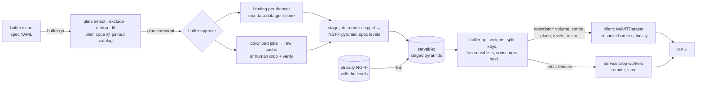

# MIA training buffers: spec → datasets → raw cache → multi-resolution crops served on demand — Spec

**Status:** draft v0.6 · 2026-10-24 · architecture only, not yet approved. v0.1 (commit `35f388e`) pre-tensorised
shards into a disk window; v0.2 (superseded) emitted miao configs over an OME-Zarr corpus; v0.3 (commit `79e6cb8`)
followed the ML lead's flow: download raw data, serve crops directly from it where chunking allows, stage to
OME-Zarr where it does not, one service chooses every crop. v0.4 validates v0.3 against the lead's MuViT demo
notebook and three diverse 2D datasets (§11): a crop becomes a multi-resolution stack with world-coordinate boxes,
staging to an NGFF pyramid becomes the one serving path for v1, and the batch contract follows MuViT, not miao. v0.5
takes the lead's answers to §8.2 and §8.3: missing metadata is guessed, for now by baked-in tables (§2, §9.8), later
by an ingestion agent. v0.6 records milestone 3 as built (§3: download inside the stage job, the manual drop through
`files.json`; §9.1: the issue repo). The v0.4 diagrams are at [MIA training buffers v0.4](https://claude.ai/artifact/Nqk7xz3jQajtPAFqw1296i). The
v0.1 diagrams at [MIA Training Buffers](https://claude.ai/artifact/NpL68fp7iVfpQ9EWApz6oj) are stale except
figures 1, 2 and 6 in outline.
**Inputs:** the spec instance
[`examples/spec-microscopy-pretrain.yaml`](https://github.com/AI-HHMI/mia-agentic-search/blob/main/examples/spec-microscopy-pretrain.yaml);
and the reduced example this repo plans from, [`buffer-2d-gray.example.yaml`](buffer-2d-gray.example.yaml);
the consumer contract:
[`examples/muvit-2D-demo.ipynb`](https://github.com/AI-HHMI/mia-agentic-search/blob/main/examples/muvit-2D-demo.ipynb),
[weigertlab/muvit](https://github.com/weigertlab/muvit) `MuViTDataset` and the paper
[arXiv:2602.24222](https://arxiv.org/abs/2602.24222); three catalog records chosen by the lead for diversity of
storage and metadata (§11); [AI-HHMI/miao](https://github.com/AI-HHMI/miao) as a reference for resampling and
normalisation only; the catalog record schema (`technical.arrays[]` with formats, axes, shapes, compression);
mia-data's snippet interface (crops-spec §5.2), whose `Array.access ∈ {chunk, plane, file}` drives the stage job's
read strategy.
**Repos:** this repo (new package `mia_buffers/`, new service `buffer-api`, client library), the buffer issue repo
`JaneliaSciComp/mia-buffers` (one issue per buffer spec), `JaneliaSciComp/mia-workflow-data` (dataset issues → approved
reader bindings), `JaneliaSciComp/mia-snippets` (reader snippets, harness), `AI-HHMI/mia-agentic-search` (catalog,
read-only).

## 0. Summary

A buffer specification filed as an issue becomes a **data pool** (the datasets it draws from, chosen by plain-code
filtering over the catalog at a pinned commit, each checked to fit the spec's crop geometry), then a **raw data
cache** of those datasets' original files on shared storage, then one **staged NGFF pyramid per volume** written
once by a stage job, then a **buffer service** that hands out crops to training clients, chosen according to the
spec's weighting, splits and sampling rules. A crop is a **multi-resolution stack**: the same patch size read at
each of the spec's pyramid levels around one world point, with each level's physical box, which is what MuViT
consumes. Every volume is read through the same built-in OME-Zarr reader after staging; datasets already published
as NGFF pyramids with the spec's levels are linked instead of converted (the only form of the v0.3 "direct" path
that survives). Two kinds of **snippet** are pluggable, **readers** (format → array, from mia-data) and
**tensorizers** (level stack → tensors), and fixed, human-owned **harnesses** compose them: `stage` runs a reader
and writes the pyramid; `tensorize` reads a descriptor's stack from the pyramid and runs a tensorizer. `tensorize`
runs in the client (local mode, the default and the first milestone) or in the service (remote mode, later). The
service is required in either, because it owns crop selection.

## 1. Lifecycle of a buffer issue

One `buffer:*` label at a time, set by the worker. Humans add `buffer:go`, `buffer:approve`, `buffer:keep`,
`buffer:retire`.

| stage | what runs | leaves when |
|---|---|---|
| `new` | | `buffer:go` |
| `planning` | resolve: `select`/`exclude`/`dedup` over catalog records at `catalog.ref`; **fit**: per array, `patch × max(levels) ≤ min(y, x)`, voxel size known, channel count admissible (§2); availability of a reader binding per dataset and of a tensorizer for the spec's `sampling` block; bytes to download; download feasibility (host allowlisted or manual); weighting preview; split-key preview | plan comment → `plan-review`; invalid spec → `needs-human` |
| `plan-review` | | `buffer:approve` → `sourcing`; spec edited + `buffer:go` → `planning` |
| `sourcing` | once per buffer: `snippets:go` in mia-snippets if no tensorizer matches, wait for the merge. Per dataset, in parallel: `data:go` on its mia-data issue if no approved binding; download job into the raw cache, or a `needs-human` sub-state asking a human to drop the files (§3); stage job per volume; recipe written. Each dataset becomes **servable** independently | servable fraction per weighting group ≥ `ready.min_fraction` (default 1.0; a spec may lower it) → `ready`; a group with no servable dataset after `sourcing.dataset_timeout_days` → `needs-human` |
| `ready` | service serves; remaining datasets keep sourcing and join when servable; weights renormalise over the servable set | no consumer for `idle.hours` → `idle` |
| `idle` | nothing | `buffer:keep` → `ready`; `retire_after_days` or `buffer:retire` → `retired` (announced on the issue first) |
| `retired` | staged pyramids deleted; raw cache entries released (deleted when no live buffer references them) | `buffer:go` starts a new round |
| `needs-human` | the comment says why | `buffer:go` |

`ready.min_fraction` and `sourcing.dataset_timeout_days` are spec fields with those defaults; the servable fraction of a
group counts datasets. Signal dedup, submit-once-by-key jobs, continue-as-new, the poller and the record-vs-live-view
split are v0.1 §9 unchanged: Temporal holds the lifecycle and job ids, the filesystem holds the caches, the service holds sampling
state and consumers.

## 2. The four questions

**Where does dataset filtering happen?** At two times, in two places, both plain code.
- *Plan time, worker:* `select.where`, `exclude`, `dedup` and **fit** over catalog records at the pinned commit
  decide the **data pool**. Fit uses `technical.arrays[]`: the coarsest level's footprint (`patch × max(levels)`)
  must fit the array's `shape` (its smallest reported shape when `shape_varies`); the box is in physical units, so
  `imaging.voxel_size_nm` is used where the record has it and **assumed** per missing axis from a table of catalog
  medians by modality (`mia_buffers/assume.py`; the plan row names the assumed axes;
  `sampling.assume_voxel_size: false` rejects such records instead). Channel policy: `patch.c` defaults to **1**
  (one channel per crop, the lead's initial experiments); with `patch.c: all` every raw
  array in the pool must have the same channel count; `patch.c: 1` and `patch.c: 3` always resolve, through a
  per-record **channel recipe** chosen from the array's channel count and modality (gray: `channel 0` | `mean` |
  `luminance`; rgb: `replicate` | `rgb` | `additive`) that the tensorizer applies; any other count needs at least
  that many channels and takes the first ones. Both tables are the static stand-in for the ingestion agent (§9.8). A
  record with several `modality` values is grouped under its first for weighting and the plan comment says so.
  Every record appears in `plan.json` with the rule that admitted or excluded it. No agent.
- *Serving time, `buffer-api`:* the spec's `weighting` (temperature over the `over` hierarchy) chooses the volume;
  the centre is uniform where the coarsest level fits; the plane (z, or the field index of a 2D stack) is uniform.
  `splits` are assigned once from the seed over **split keys**, not volumes: the recipe names the key (default the
  volume; a dataset can declare a regex over file paths, such as the TCGA case id or the source folder, or the plane
  index), so one file holding 25 fields splits 20/2/3 instead of all-or-nothing. **Train is a stream**: fresh
  centres every call, overlap allowed, because MAE pretraining redraws every epoch and the coarse footprint makes
  non-overlap impossible on small volumes (§11). The ledger records what was served, for reproduction, and reports
  coverage per volume; the overlap cap of v0.3 is gone. **Val and test are frozen lists**: generated once per split
  from the seed, served in index order, identical every epoch. The service is the only sampler, so two consumers of
  one buffer see one distribution.

**Where does reading happen?** In whoever tensorises: the client library (local mode) or the service's crop
workers (remote mode). Both read the **staged pyramid** of the descriptor's volume with the built-in OME-Zarr
reader. v0.3's direct path (reading raw files through the dataset's reader snippet at serving time) is dropped for
v1: MuViT needs every level of the pyramid, and none of the lead's three example datasets stores one, so direct
reading would serve one level and compute the rest on every crop. A dataset already published as an NGFF pyramid
holding the spec's levels is **linked** into `staged_root` rather than converted; that is the whole direct path.
Reader snippets are used by the stage job only, exactly as mia-data uses them today.

**Where is raw data cached?** `raw_root/<record-id>/` on large shared storage: the original files, downloaded by
plain jobs from the record's URLs (or the binding's file list), checksummed against the record's validators,
resumable, byte-capped; or dropped there by a human when the host is not reachable from a job (§3). Shared across
buffers and reference-counted; a dataset is downloaded once however many specs want it.
`staged_root/<record-id>/<volume>.zarr` holds the pyramid; it depends on the spec's levels and patch, so its name
carries a `<levels-key>`. Both are regenerable, so neither needs backup; `state_dir` (specs, plans, ledgers,
service database) does. The spec's `cache` block (node-local disk, prefetch depth, workers) is the client library's
local prefetch of crops it has been promised by `next`.

**What needs code snippets?** Two kinds, composed by harnesses (§4).
- **Reader snippets**, one per format and layout: `open_array(src, io) → Array` with lazy `read(region)` and
  `access`. The stage job reads whole arrays through them, honouring `access` (`chunk`: read by box; `plane`: by
  plane; `file`: fetch once, iterate members). They come from mia-data exactly as today (match, develop via autodev,
  human approval of preview crops, `data:done` binding).
- **Tensorizer snippets**, one per output convention: `tensorize(stack, params) → Sample`, pure, declared shapes
  and dtypes, no I/O. The first one is `muvit-2d`: normalise each level (`normalize` block; percentile, not `/255`,
  because the pool mixes uint8 and uint16), cast to `dtype`, stack to `img` (L, C, Y, X), compute `bbox` (L, 2, 2)
  in nm from the level's scale and translation, with the max corner at the last pixel as the notebook does,
  nearest-sampled `label` (L, Y, X) when a label layer is present, plus `pixel_size` and `meta`. A spec whose
  tensor demands no existing tensorizer describes goes through the develop path (a `snippets:go` issue that autodev
  turns into a `tensorizers/<name>/` PR, tested on real stacks, merged by a human), exactly as readers do.
Harnesses, samplers and the service are not pluggable: they are the human-owned code every crop goes through.

## 3. Sourcing a dataset

For each dataset in the data pool, three independent activities run under the one workflow, each submit-once by key:

1. **Binding.** Read `<dataset folder>/binding.yaml` written by mia-data's publication (a small mia-data change,
   §6). If the dataset issue is not `data:done`, add `data:go` (the buffer bot is a trusted labeler) and wait on the
   poller's `dataset_update`. Timeout or `data:ineligible` drops the dataset and re-posts the plan.
2. **Download.** A plain job fetches the binding's files into `raw_root/<record-id>/` with the harness `io` (hosts
   limited to the dataset's, validators recorded, CRCs checked, resumable per file). The job writes
   `files.json`: url, path, size, validators. Large datasets stream to the cache over several jobs under
   `limits.job_bytes`. When the plan found the host not allowlisted or the record offers no fetchable archive (a
   Google Drive folder, for instance), the dataset enters a `needs-human` sub-state whose comment lists the files
   to place under `raw_root/<record-id>/incoming/`; the worker verifies them against the binding's file list and
   sizes, moves them into place and writes the same `files.json` with `source: manual`.
   *As built in milestone 3 (2026-10-24):* download runs inside the stage job, which has the binding's hosts and the
   raw cache read-write (the reader snippets are reviewed code, as in mia-data's trusted crop job); a separate
   download job returns when datasets must stream over several jobs. A dataset is sent to the drop path when a URL's
   host is not in the csub policy or the binding uses `manual://<record>/<name>` URLs; the comment lists
   `incoming/<name>` ← url pairs (the name is the URL's file name when it is unique and plain, else `file-<i>`); the
   worker accepts regular, non-empty files, records `{size, sha256}` as the validators, keys the file as the
   harness does and lists it in `files.json`; the harness resolves a URL through `files.json` whenever its host is
   not allowed to the job, so the stage job of a dropped dataset runs with no network at all. The binding's own file
   sizes are not checked (bindings carry none).
3. **Staging.** `harness stage <binding> --levels <spec levels> --patch <patch>` opens every array through the
   snippet with the cache mounted read-only and writes one NGFF pyramid per volume at `staged_root/…`:
   zarr v3, NGFF 0.5 (`ome` attributes key, the layout the demo notebook reads), a `raw` group and one `label/<name>`
   group per label layer, every level the spec names (mean downsampling for raw, nearest for labels), scale and
   translation in nm from the record's voxel size, chunks equal to the patch, a 2D stack's field axis kept as a
   plane axis so one volume holds its fields. A verification pass re-reads a sample of level-0 chunks through the
   snippet and checks each coarser level against a fresh downsample. The job runs reviewed code only, mounts the raw
   cache read-only and writes to `staged_root` only. A dataset already in this layout with the levels present is
   linked, not copied, after the same verification. Axis order of the written arrays follows the NGFF
   recommendation (`t c z y x` subset); the lead's existing `x y z` crops are read by the same reader with an axis
   map, so the client never sees the difference.

The sourcing step also writes the dataset's **recipe** (§4): binding, split key, the tensorizer matched to the
spec's `sampling` block with its params, statistics for `normalize.scope: volume|dataset`, and the harness pin. A
volume is **servable** when it has a recipe and a verified pyramid. The worker registers servable volumes with the
service (`PUT volumes`), with their weights, split-key values and plane count, and the service begins drawing from
them.

## 4. Snippets and harnesses: composition

Snippets are small, immutable, independently approved units; harnesses are the fixed programs that compose them.
Every harness takes a **recipe**: the frozen tuple (reader binding, split key, tensorizer name + params, harness
pin) written per (dataset, spec) at sourcing time and referenced by every crop descriptor.

A **crop descriptor** is `(buffer, seq, volume, plane, centre_nm, levels, recipe_id)`. It is the unit the service
hands out, the ledger stores and a run replays. The `tensorize` harness turns it into a sample: for each level it
derives the pixel box of `patch` around the centre at that level's scale, clamped inside the array as the notebook
does, reads it from the pyramid, and passes the stack of (array, scale, translation, box) to the tensorizer.

| harness | composes | in → out | runs in |
|---|---|---|---|
| `stage` | reader → writer | binding + levels + patch → NGFF pyramid per volume, label layers alongside, verified | stage job |
| `tensorize` | OME-Zarr reader + tensorizer | recipe + descriptor → `Sample` (`img` (L, C, Y, X), `bbox` (L, 2, 2) nm, optional `label` (L, Y, X), `pixel_size`, `meta`) | client library (local) or service crop worker (remote) |
| `crop` | reader → PNG preview | mia-data's existing test crops for human review of a binding | mia-data jobs, unchanged |
| `test-tensorizer` | OME-Zarr reader + tensorizer on a PR head | real stacks from a staged volume → pass/fail against `describe()` | autodev test job, private cache |

v0.3's `probe` harness is folded into `stage`, which reports the same per-volume facts (axes, shape, dtype, voxel
size, `access`) before writing. The tensorizer owns everything between the stack and the GPU; the harness owns the
reads, the contract check (shapes and dtypes exactly as `describe()` declared, and MuViT's own sanity check on the
first sample) and provenance. The contract is MuViT's: `img` and `bbox` are mandatory, labels are a separate key, L
is the level axis. v0.3's `label_axis: l` is dropped (§8). miao's resampling and normalisation code remains the
reference to borrow from.

Composition is by data, not by import: a tensorizer never imports a reader, a reader never imports a tensorizer,
neither imports the harness beyond its API module.

## 5. The buffer service and the client

`buffer-api` is one HTTP service per deployment, reachable inside the cluster network, with a SQLite ledger under
`state_dir` and the caches mounted read-only. It holds no credentials and deletes nothing.

| call | who | effect |
|---|---|---|
| `PUT buffers/<id>` | worker | spec hash, levels, patch, weighting rules, split fractions, seed, ready threshold |
| `PUT buffers/<id>/volumes/<vol>` | worker | a servable volume: pyramid path, shape and scale per level, plane count, label layers, weight, split-key values, statistics |
| `POST buffers/<id>/consumers` | client | register `{name, host, pid, rank, split, mode}` → `consumer_id`; heartbeat every `consumers.heartbeat_s` |
| `GET buffers/<id>/next?n=` | client, train | the next `n` **crop descriptors**: volume by weight over servable volumes of this split, plane and centre uniform, recorded in the ledger before returning. `204` + `Retry-After` when nothing is servable yet |
| `GET buffers/<id>/split/<name>?from=&n=` | client, val and test | descriptors `from..from+n` of the frozen list, generated on first request from the seed and stored |
| `GET crops/<seq>` | client, remote mode | the tensors for a descriptor (safetensors body), produced by a service crop worker |
| `GET buffers/<id>/status` | anyone | servable fraction per group, draws per group vs target, coverage per volume, consumers, underrun |

**Client.** `BufferDataset(url, buffer, split, n_samples, mode)` subclasses `muvit.data.MuViTDataset`: `ndim`,
`levels` and `n_channels` come from the buffer; `__len__` is `n_samples` for train (a virtual epoch, as in the
notebook) and the frozen list's length for val and test; `__getitem__(idx)` for train ignores `idx` and takes the
next prefetched descriptor, for val and test it indexes the frozen list, so `shuffle=True` and multiple DataLoader
workers behave. Each worker process registers its own consumer lazily. The sample is the `tensorize` harness's
`Sample`, so the demo notebook's training cells run unchanged against it. **Local mode** (default): the client
reads the pyramid from shared storage, tensorises, and prefetches into the spec's node-local cache; no bytes cross
the service. **Remote mode**: the client only calls `next` and `crops`. The descriptor is the same object either
way, so a run can be reproduced from the ledger alone.

## 6. Changes to existing code

1. **mia-data publication writes the approved binding** to `<dataset folder>/binding.yaml` with its sha256 in the
   manifest (wire-format rule: new field with a default). Buffers read bindings from there, never from comments.
2. **mia-data trusts the buffer bot** for `data:go`.
3. **mia-snippets** gains `tensorizers/<name>/` (same CI rules as `snippets/`: one new directory per PR, no
   edits), the harness API types `Stack`, `TensorSpec`, `Sample`, the harnesses `stage`, `tensorize`,
   `test-tensorizer` (§4), and a built-in OME-Zarr pyramid reader with an axis map. Reader snippets are
   unchanged. autodev's `snippets` deployment accepts tensorizer issues: its prompt names both directories and
   `required_checks` gains `mia-buffers/tensors`.
4. **`mia_buffers/`**: `specmap`, `select`, `plan` (fit, weights, split keys), `config` (mia_buffers.yaml: mia-data's
   sections plus `raw_root`, `staged_root`, `service`, `sourcing`), `models`, `jobspec` (the stage job, the catalog
   snapshot), `drop` (manual-drop names, the cache key, `files.json`), `activities` (admit, plan, bindings, stage
   job, drop verification, registration, comments), `poll`, `workflows` (`MiaBuffer`, `MiaBufferPoll`), `status`
   (comments), CLI (`mia-buffers plan <spec>` offline; `serve`, `register`; `worker`, `schedule`, `init-labels`),
   the `buffer-api` service, the client library. `mia-buffers source <dataset>` (one dataset by hand) is not built.
5. **`mia_ops`**: app kinds `mia-buffers` (worker + broker; caches read-write) and `buffer-api` (listening
   service; caches read-only).

## 7. Trust boundaries

Crops-spec §9 and v0.1 §10 hold. Downloaded or human-dropped files are untrusted bytes read only by reviewed
snippet code in the stage job; everything after staging is read by the built-in zarr reader. The stage job and the
service's crop workers run reviewed code at pinned commits; the match agent and PR-head test jobs never see the
shared raw cache read-write. Consumers are untrusted: they can register, heartbeat, pull descriptors and fetch
tensors for descriptors they were given; they cannot influence selection beyond declaring a split. The spec is
untrusted text, safe-loaded and schema-validated; every record id and URL in the plan is re-read from the catalog,
never taken from the spec.

## 8. Flags for the ML side

1. **Fields the record schema lacks** for `select.where`: `sample_type`, `content_hash` for `dedup`,
   `annotations.encoding` (lives in `technical.arrays[]`), `auto-predict` vs the schema's `automatic`.
   `min_size_voxels` is now the per-array fit rule and should be stated per array, not per record.
2. **Voxel size must be known** for a world-coordinate bbox. *Resolved (lead, v0.5):* guess it. The harvesting agent
   infers a plausible value, with a range, from what it knows (membrane thickness, mitochondrion size, modality) and
   checks it against the pixels (xz cross-sections for the z step). Until then a table of catalog medians by
   modality fills missing axes and the plan marks them assumed (§2, §9.8). CEM-MitoLab is served at an assumed 8 nm.
3. **Channels.** *Resolved (lead, v0.5):* the ingestion agent answers, per dataset, "how is a single raw sample made
   from this data" and "how is an RGB sample made" (take a channel, mix, use the RGB planes, replicate gray), and
   the index grows as the list of questions grows. Until then the recipe comes from channel count and modality
   (§2); `patch.c: 1` or `3` is therefore always satisfiable and a mixed pool is fine.
4. **bbox unit is model-relevant** (rotary embeddings run on it). The demo uses nm; the example spec says um. The
   default here is nm.
5. **`label_axis: l`** is dropped: L is MuViT's level axis and labels are a separate `label` key. Remove the field
   from the spec grammar or document it as ignored.
6. **Normalise `modality` to families** (the catalog's `tools/readiness.py` `FAMILIES`) for `weighting.over` and
   `normalize.scope: dataset`; and decide how a multi-valued `modality` is grouped (first value here).
7. **Local mode is first**, as the demo implies. Remote mode is the last milestone.

## 9. Open questions (defaults in bold)

1. **Where buffer issues live:** resolved 2026-10-24: the new repo `JaneliaSciComp/mia-buffers`.
2. **Train overlap:** **unlimited, coverage reported**; a least-recently-covered preference at level 0 if a run
   shows it matters.
3. **Service placement and crop workers for remote mode:** **service host pool, cluster-internal, self-identified
   consumers**; csub-driven workers and SSO if remote mode becomes the norm or leaves one group.
4. **Raw cache retention:** **reference-counted by live buffers, deleted on last retire**, with a root quota that
   queues sourcing (v0.1's admission rule) when exceeded.
5. **Reproducibility of a run:** **the ledger is the record** (seq → descriptor); replaying a run means replaying
   descriptors, not re-sampling.
6. **Staged axis order:** **NGFF canonical, axis map in the reader**, or match the lead's existing `x y z` crops.
7. **Direct serving from pyramidal raw formats** (OME-Zarr, N5 multiscale, pyramidal TIFF): **link when the levels
   match, otherwise stage**; a snippet-backed direct path returns only if staging volume becomes the bottleneck.
8. **Metadata gaps and the ingestion agent (follow-up).** The pipeline needs a fixed list of facts per raw array;
   the catalog answers some and the rest are guessed. Today the guesses are baked-in tables (`mia_buffers/assume.py`,
   medians over the records that document the fact at `ab6a013d`). The lead's direction is an agent that runs when a
   dataset is indexed: it lists what is missing, infers each item from context and simple detective work, states a
   range or confidence, and checks inferences against the pixels; the index is updated as the question list grows.
   The natural host is the per-record match step mia-data already runs (it has the record, the file headers and a
   sandbox), writing an `evaluation` block beside the binding. **Replace the tables with that step; keep the tables
   as its fallback.** Gap list at `ab6a013d` (1,940 records):

   | fact | catalog source | missing | static stand-in now | agent later |
   |---|---|---|---|---|
   | dimensionality | `imaging.dimensionality` | 0 | — | — |
   | array axes and shape | `technical.arrays[]` | 259 | rejected: "no array shape" | read the files |
   | voxel size y, x | `imaging.voxel_size_nm` | 1,161 | median by modality (table) | infer from content, range, pixel check |
   | voxel size z (3D records) | `imaging.voxel_size_nm.z` | 260 of 655 | median z step by modality | xz cross-section check |
   | channel count | `technical.arrays[].axes` c or s | 259 | treated as 1 | read the files |
   | channel meaning (which stain, RGB or not) | not in the schema | all 761 multi-channel | recipe by count and modality | per-dataset gray and rgb recipes |
   | intensity range | `technical.arrays[].dtype` + per-crop percentiles | 0 | percentile normalisation | per-dataset normalisation |
   | label encoding | `technical.arrays[].encoding` | sparse | pass-through int32 | per-layer encoding |
   | licence | `license.spdx` | 3 | gated by `allow_unknown` | — |

## 10. Build order

| # | milestone | done when |
|---|---|---|
| 0 | `specmap` + `select` + fit offline over a catalog snapshot | the example spec yields a record table with a rule per record; CEM-MitoLab is rejected for the demo's levels with the footprint reason and, at patch 64 and levels 1,2, for its unknown voxel size (§8.2); schema violations refused with the validator's message |
| 1 | harness API, `stage`, OME-Zarr pyramid reader, `tensorize`, the `muvit-2d` tensorizer | the U937 and BCSS records stage from their raw files; the lead's existing crop links; `tensorize` on a descriptor yields a sample that passes `MuViTDataset._sanity_check` and matches the notebook's `img` and `bbox` for the same centre and levels; a tensorizer output mismatching `describe()` fails the harness |
| 2 | `buffer-api` + local-mode `BufferDataset` against hand-registered volumes | the demo notebook's training cells run on the two staged datasets with the spec's weights; val is identical across epochs; two consumers share one distribution; a killed consumer costs a delay only. *2026-10-23: done against the staged U937 volume (`mia-buffers serve`, `register`, `BufferDataset`; `docs/development.md`): frozen val identical across epochs, disjoint planes per split, two consumers with distinct draws, 10.8 samples/s in one process; the notebook's torch cells were not run here (no torch in this environment), BCSS awaits its manual drop.* |
| 3 | `MiaBuffer`/`MiaBufferPoll`: go → plan → approve → sourcing (download or manual drop, stage, register) → ready, with datasets already `data:done` | an issue reaches `buffer:ready` progressively as datasets become servable; BCSS waits in the manual-drop sub-state and joins after the drop; a redelivered `go` does nothing  *2026-10-24: built (`mia_buffers.workflows`, `activities`, `poll`; `docs/development.md`). Verified on Temporal's test server with mocked activities (progressive ready, manual drop, stale and busy labels, timeout, replay of a recorded history) and on real data without a worker (no Temporal server or csub broker on the dev host): issue #1 of `JaneliaSciComp/mia-buffers` admitted and planned (pool 421 of 1,940, 4 manual, 14 groups, 18 s); the U937 binding read from `storage_root`; its stage job command run by hand with the job's environment (35 s from the cache, 0 bytes fetched, 32 + 32 checks, `files.json` written) and again with no hosts allowed (30 s, served by `files.json`); registered through the activities and consumed at 13.4 samples/s, val identical across epochs; the BCSS drop verified and keyed, its stage job then failing for want of a `png-pairs` reader snippet, which is milestone 4's `data:go`. The GitHub App installation must be extended to the new repo before the worker runs as the bot.* |
| 4 | sourcing through mia-data (`data:go`), binding publication, statistics for `normalize.scope: volume/dataset` | a spec naming an unmatched dataset reaches ready after the human approval on the dataset issue |
| 5 | retire, reference-counted caches, root quota, operations (`status`, `check`) | an idle buffer is retired with notice; a shared dataset survives; a full root queues sourcing with a comment |
| 6 | remote mode: service crop workers, `GET crops/<seq>` | a client with no cache mount trains from tensors over HTTP |

## 11. Validation against the MuViT demo and three datasets

The lead's notebook defines a dataset over one NGFF pyramid: for each sample it draws a centre where the coarsest
level fits and a plane, reads `patch_size` pixels at every level around that centre, and returns `img` (L, C, Y, X)
scaled to [0, 1] and `bbox` (L, 2, 2) in nm from the level's scale and translation. Train draws fresh crops every
epoch with a virtual length; val fixes crops by seed; the split is a plane range within the volume. `MuViTDataset`
checks `img` and `bbox` shapes on construction, is map-style, and fixes `n_channels` per dataset. The three records
the lead named, against the v0.3 design:

| | CEM-MitoLab (EMPIAR-11037) | BCSS (GitHub) | U937 confocal (Zenodo 20797339) |
|---|---|---|---|
| raw layout | ~43k uint8 TIFF pairs in one 3 GB zip | 151 deflate PNG pairs, RGB | one uncompressed ImageJ TIFF, `tcyx`, plus three mask stacks |
| snippet `access` | `file` | `file` | `chunk` |
| pyramid in the raw | no | no | no |
| fits 256 at levels 1,2,4 | no: patches are 224 or smaller | yes (2467 × 3394) | yes (2048 × 2048) |
| voxel size | unknown | 250 nm | 45 nm |
| channels, dtype | 1, uint8 | 3, uint8 | 3, uint16 up to 41630 |
| download | https zip | Google Drive folder, not allowlisted, no archive | four direct URLs |
| split key | source folder | TCGA case id in the file name | field index `t` |

What changed in v0.4 because of this: the multi-resolution descriptor and MuViT batch contract (§4, §5), staging
as the one path (§2), the plan-time fit rule and channel policy (§1, §2), split keys and frozen val lists (§2, §5),
unlimited train overlap (§2, §9), the manual-drop download path (§3), the staged layout pinned to zarr v3 and NGFF
0.5 (§3), nm as the bbox unit (§8), and the build order starting from staging and the local client (§10). The spec
was already ahead of the notebook in one place: the notebook divides by 255, which is wrong for the uint16 confocal
stack; the percentile tensorizer handles both dtypes.
