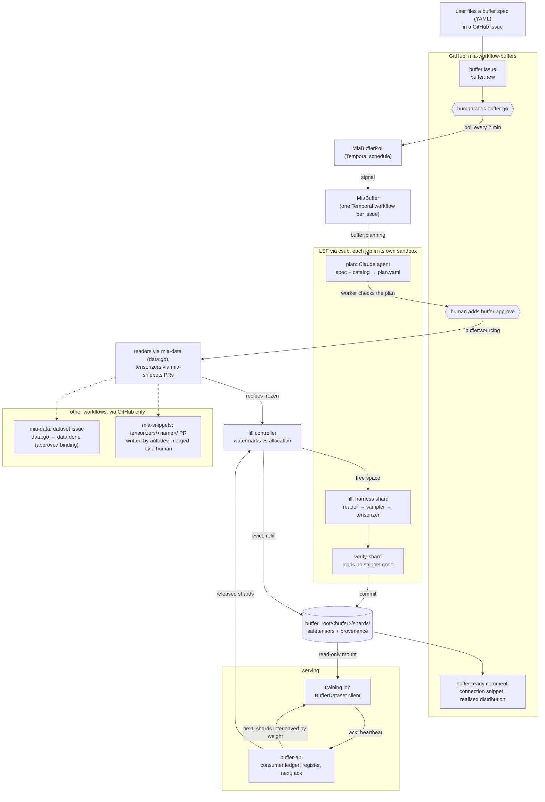

# MIA training buffers: spec → sourcing → tensor pipelines → served, bounded buffers — Spec

**Status:** draft v0.1 · 2026-10-21 · architecture only, not yet approved. Opens the design; the YAML schema for a
buffer specification is owned by the ML side and is **not** defined here (§5 lists what this system needs from it).
**Diagrams:** [MIA Training Buffers](https://claude.ai/artifact/NpL68fp7iVfpQ9EWApz6oj) (system context, lifecycle,
recipe pipeline, disk window, consumer protocol, planning, storage layout) accompanies this note; the overview is
repeated below in mermaid.
**Repos:** this repo (new package `mia_buffers/`, new service `buffer-api`), a new issue repo for buffer requests
(working name [JaneliaSciComp/mia-workflow-buffers](https://github.com/JaneliaSciComp/mia-workflow-buffers), §13),
[JaneliaSciComp/mia-workflow-data](https://github.com/JaneliaSciComp/mia-workflow-data) (dataset issues: the source
of approved readers), [JaneliaSciComp/mia-snippets](https://github.com/JaneliaSciComp/mia-snippets) (reader snippets,
harness; gains `tensorizers/`), [AI-HHMI/mia-agentic-search](https://github.com/AI-HHMI/mia-agentic-search) (catalog,
read-only).

## 0. Summary

A user who wants to train a model files a GitHub issue carrying a **buffer specification**: a YAML document (schema
defined by the ML side) that says which tensors a training sample consists of, how many samples, and how they
should be distributed over the catalog (so much EM with mitochondria labels, so much light microscopy with nuclei,
…). A durable Temporal workflow owns the issue from there:

1. **Plan.** An agent reads the spec and the catalog and proposes a **sourcing plan**: for each stratum of the
   requested distribution, the datasets that can supply it, how many samples each should contribute, and the gaps.
   The worker checks the plan with plain code (capacity, licence, eligibility, the arithmetic of the distribution)
   and posts it. **A human approves the plan** before any data is read.
2. **Source.** Every dataset in the plan needs an approved **reader** (a mia-snippets snippet plus binding) and every
   tensor needs a **tensorizer** (the output snippet: array patch → tensor as the spec demands). Readers come from
   mia-data: a dataset with a `data:done` issue already has one; the others get `data:go` and are followed until
   their binding is approved. Tensorizers are matched from `mia-snippets/tensorizers/`, or developed through autodev
   when none fits, exactly as reader snippets are today. Reader + sampler + tensorizer for one dataset and stratum is
   a **recipe**, frozen with the buffer.
3. **Fill.** Plain cluster jobs run the recipes and write **shards**: immutable files of K GPU-ready samples
   (safetensors, §7.3). A verify job that loads no snippet code checks every shard against the spec; the worker
   commits it to the buffer. The workflow keeps the buffer between a low and a high watermark, never above its
   **disk allocation**.
4. **Serve and notify.** A small HTTP service, `buffer-api`, hands shards to training processes, tracks who is
   reading what, and tells the workflow which shards every consumer has finished with. When enough is in the
   buffer the issue gets `buffer:ready` and a comment with the connection snippet. In **stream** mode, released
   shards are evicted and the space refilled, so an unbounded stream of fresh samples runs through a bounded
   directory. In **epoch** mode the buffer is a finite dataset that is produced once and kept until retired.

Disk space is coordinated, not hoped for: a buffer is admitted to filling only when its allocation fits the root's
allocation next to the other live buffers; a shard is deleted only after every registered consumer has acked it or
gone silent past its lease; a buffer nobody has read for a configured time is paused, then retired after a warning on
its issue. All of that is visible on the issue as labels and append-only comments.

The pieces this reuses are the ones mia-data already has: GitHub-as-UI with labels as state, one Temporal workflow
per issue, csub jobs in sandboxes, agent proposes / worker verifies, idempotent publication, snippets that are
immutable and human-approved. What is new: the planner, tensorizers and recipes, the shard format and its verifier,
the fill controller, the buffer service and its consumer protocol, and the eviction and quota rules.

### Overview



## 1. Goals and non-goals

**Goals**
- **One issue per buffer request**, from spec to "training can begin", with every stage and decision on the issue.
- **The requested distribution is honoured and reported.** The plan says how the distribution will be met and where
  it cannot be; the ready comment reports the realised distribution against the requested one; in stream mode every
  window of the buffer approximates the distribution, not just the whole.
- **Any source, any tensor.** A recipe composes an input snippet (reader) with an output snippet (tensorizer). Both
  are small, immutable, human-reviewed and independently developed; adding a format or a tensor convention never
  changes the orchestrator.
- **Humans approve before reads and before training.** The plan is approved before any dataset is read; readers
  and tensorizers are approved through their existing review gates; the ready comment is explicit about what the
  buffer contains.
- **Bounded disk, by construction.** No buffer exceeds its allocation; the sum of live allocations never exceeds the
  root's; eviction is driven by consumer acknowledgements, never by guesswork; abandoned buffers are reclaimed with
  notice.
- **Reproducible and traceable.** Every sample records its dataset, volume, box, seed, reader, tensorizer and recipe
  hash. A shard can be regenerated from its recorded inputs.
- **Restarts recover.** The worker reattaches to running jobs; committing a shard twice is a no-op; evicting a shard
  twice is a no-op; the service rebuilds its view from the manifests on disk.

**Non-goals (for now)**
- Defining the buffer specification schema (§5). We consume it and say what we need from it.
- Augmentation, batching, shuffling within a batch, mixed precision policy, pinning to GPU memory. The client library
  yields samples; the training code owns the rest.
- Serving bytes off the cluster. Consumers run where the buffer root is mounted; the service serves metadata and
  coordination, the filesystem serves tensors (§8).
- Resampling across voxel sizes beyond integer stride selection, registration, stitching (§15).
- Model training, evaluation, or any feedback from training into sampling.

## 2. Context

- **mia-data** (spec `notes/mia-crops-spec.md`) gives every downloaded catalog dataset an issue; `data:done` means a
  human approved a binding (reader snippet + parameters) after seeing test crops. The binding is exactly the
  "approved reader" this design needs; the 256×256 PNGs are not. Snippets are n-dimensional readers already
  (`Array` with `axes`, `shape`, `dtype`, `access`), so 3D boxes are a harness change (sampler and writer), as
  crops-spec §15 anticipated.
- **mia-snippets** owns `SPEC.md`, the harness and `snippets/<name>/`, with CI that enforces immutability and
  one directory per PR. Tensorizers fit the same contract and CI with a second top-level directory.
- **autodev** turns a labelled issue into a reviewed PR; its `snippets` deployment already develops reader snippets
  from issues the mia-data bot opens. The same deployment can develop tensorizers.
- **Catalog records** carry `imaging.modality`, organism, `technical.arrays[]` with roles, axes, shapes, dtypes and
  voxel sizes, and label metadata (`segmentation_type`, class names where present). These are the facets a
  distribution can be defined over. Vocabulary is not fully normalised across records; the planner must map spec
  facets to record values (§6.1), and that mapping is part of what the human reviews.
- **Storage.** A buffer root on shared storage that the worker host, compute nodes and training nodes all mount.
  `/nrs`-class storage is fast and large but not backed up, which suits buffers (every shard is regenerable);
  `state_dir` stays on backed-up storage, as `docs/deployment.md` says.
- **Consumers** are training jobs on the cluster (LSF, GPU queues), typically one or a few processes per buffer, each
  wanting a stream of samples or a fixed dataset for several epochs. They come and go; some die without cleanup.
- **Temporal, csub, agentic-sandbox** as in the other two workflows (`docs/deployment.md` for production).

## 3. Components

| where | what | changes |
|---|---|---|
| `mia-workflow-buffers` (working name) | one issue per buffer request; labels `buffer:*` show the stage (§4) | new repo, or a label family in mia-workflow-data (§13) |
| `mia-snippets` | `tensorizers/<name>/` (output snippets, §6.3); harness gains `sample` (n-D boxes), `tensorize`, `shard`, `verify-shard` (§7) | PRs; same CI rules as `snippets/` |
| this repo, `mia_buffers/` | config, models, planner checks, recipe builder, fill controller, shard commit and eviction, `MiaBuffer`, `MiaBufferPoll`, CLI, the `buffer-api` service, the client library | new package |
| this repo, `autodev/` | GitHub client, csub runner, await queue, trusted bots | reused by import |
| this repo, `mia_data/` | bindings and dataset stage labels, read through GitHub, not imported | unchanged; the buffer bot is a trusted labeler of `data:go` |
| Temporal | namespace `mia-buffers`, queues `mia-buffers`, `mia-buffers-await` | admin step |
| `buffer-api` | HTTP service: shard index, consumers, leases, acks, budget (§8) | new service in `mia.yaml` |
| `mia_buffers.client` | `BufferDataset`: registers, heartbeats, reads shards, acks | pip-installable from this repo |

The three workflows interact only through GitHub (labels, issues, PRs, statuses) and the filesystem, never through
Temporal signals across namespaces, as today.

## 4. Lifecycle of a buffer issue

```
buffer:new ──(buffer:go)──> buffer:planning ──> buffer:plan-review ──(buffer:approve)──> buffer:sourcing
  sourcing: every dataset has an approved binding, every tensor a merged tensorizer ──> buffer:queued (no allocation free)
                                                                                    └─> buffer:filling
  filling ──ready threshold reached──> buffer:ready ──(stream: refill as shards are released)──> buffer:complete
  ready/complete ──no consumer for idle_hours──> buffer:idle ──retire_after_days, or (buffer:retire)──> buffer:retired
  idle ──(buffer:keep)──> ready (idle clock reset)    any stage ──> buffer:needs-human (comment says why)
```

- `buffer:go`, `buffer:approve`, `buffer:retire`, `buffer:keep` are human labels, accepted from people with write
  access, delivered by the poller as signals with their label event id and removed afterwards (dedup by event id,
  as mia-data does).
- **plan-review.** The plan comment shows strata, datasets, quotas, capacities, the facet mapping the agent chose,
  and the gaps. `buffer:approve` accepts it as posted. To change it, the human edits the spec in the issue body (or
  posts a `/replan <note>` comment) and adds `buffer:go` again: a new round plans again from the edited spec. The
  worker never edits the spec.
- **sourcing** can take days (snippet PRs, dataset approvals). The issue shows a checklist comment of what it is
  waiting for, updated by appending, and the workflow wakes on `dataset_update` and `pr_update` signals.
- **queued.** The buffer's allocation does not fit next to the live buffers'. The comment names the buffers holding
  the space and their idle state. The workflow re-checks on a timer and when a buffer retires.
- **ready** means "training can begin": the ready threshold (§7.5) is met, the service lists the buffer, the comment
  carries the connection snippet. Filling continues in the background in stream mode.
- **complete.** Every planned sample has been produced (and, in stream mode, released). Epoch buffers stay complete
  until retired; stream buffers with no `samples` bound never complete.
- **idle, retired.** Disk reclamation with notice: `idle` posts a comment with the retire date; `retired` deletes the
  shards and the service entry and leaves `buffer.json`, `plan.json`, `recipes/` and the final manifest (tombstones
  only) in place as the record.
- **Re-trigger.** A `buffer:go` on `needs-human`, `retired` or `plan-review` starts a new round from planning with a
  new round id; the spec is re-read from the issue. A `go` while a round is working is refused as busy.
- **Comments are append-only**, every stage change posts one, and labels are set only by the worker.

## 5. The buffer specification

The schema is defined and versioned by the ML side. This system pins the schema it validates against
(`spec.schema_repo` + commit in config, §10), validates the YAML from the issue body against it, and then reads the
concepts below through a thin adapter (`mia_buffers/specmap.py`), so a schema change is an adapter change and a
config pin, not a redesign. If the schema lacks a concept, the adapter supplies the default marked here and the
plan comment says so.

| concept | what the planner and recipes need | default if absent |
|---|---|---|
| buffer name, mode | `epoch` (finite set, kept) or `stream` (ring, refilled) | `epoch` |
| sample count | total samples; unbounded allowed in stream mode | required in epoch mode |
| sample tensors | per tensor: name, shape (with axes semantics), dtype, source role (`raw`, `label`, derived), normalisation or encoding | required |
| spatial box | the physical or voxel box a sample is cut from, and the voxel size policy (exact / range / stride) | voxel box from the tensor shape, any voxel size |
| distribution | strata, each with a weight and a selector over catalog facets (modality, organism, label class, dimensionality, voxel size range, licence), plus a cap on any one dataset's share of a stratum | one stratum, everything eligible, cap 0.4 |
| splits | named splits with fractions and the unit they are disjoint by (`source_volume`, `dataset`) | `train` only |
| seed | reproducibility | from `workflow.random()` at admission |
| licences | allowed SPDX ids | mia-data's `crops.licences` |
| size hints | preferred shard size, allocation request | config defaults |

An illustration of a spec with these concepts, **not the schema**:

```yaml
buffer: {name: em-mito-128, mode: stream, samples: 200000, seed: 7}
sample:
  box: {shape: [128, 128, 128], voxel_size_nm: {target: [8, 8, 8], tolerance: 0.25}}
  tensors:
    - {name: raw,   shape: [1, 128, 128, 128], dtype: float16, source: raw,   normalize: {method: zscore, scope: sample}}
    - {name: label, shape: [128, 128, 128],    dtype: int64,   source: label, encode: {classes: [background, mitochondria]}}
distribution:
  strata:
    - {name: em-mito,   weight: 0.5, select: {modality: EM, label_class: mitochondria}}
    - {name: lm-nuclei, weight: 0.3, select: {modality: [LM, fluorescence], label_class: nucleus}}
    - {name: em-any,    weight: 0.2, select: {modality: EM}}
  max_dataset_share: 0.4
splits: {train: 0.9, val: 0.1, disjoint_by: source_volume}
```

The spec is untrusted text from an issue: parsed with `yaml.safe_load`, size-limited, validated against the pinned
schema; a failure is a `needs-human` comment quoting the validator, never a guess. The admitted spec is frozen under
`state_dir` and in the buffer directory; its sha256 is `spec_hash`, carried into every shard.

## 6. Planning and sourcing

### 6.1 The plan (agent proposes, worker checks)

A **plan job**, a Claude agent in a sandbox, reads the frozen spec, the catalog records (a snapshot at a pinned
commit) and a summary of mia-data's issues (dataset → stage, binding, smoke shapes, eligibility), and writes
`plan.yaml`:

```yaml
spec_hash: …
facets:                       # how spec vocabulary was mapped to record values, with reasons
  label_class/mitochondria: {matched: [mito, mitochondria, Mitochondrion], reasons: [...]}
strata:
  - name: em-mito
    weight: 0.5
    datasets:
      - {record: jrc_hela-2, binding: {issue: 17, stage: done}, volumes: [...], capacity_samples: 48000, reasons: [...]}
      - {record: …,          binding: {issue: 31, stage: new},  capacity_samples: 12000, reasons: [...]}
    gaps: ["only 2 datasets match; 1 is licence-excluded (CC-BY-NC)"]
tensorizers: {raw: {name: zscore-float16, params: {...}}, label: {name: class-ids-int64, params: {...}}}
```

The agent may run read-only harness commands against the snapshot (`harness capacity <binding> --box ...`) to
estimate capacity, and nothing else. The worker then runs `check_plan` (plain code, no agent):

- every record exists at the pinned catalog commit; licence allowed; every binding reference points at a real
  mia-data issue for that record; stages are re-read from GitHub, not trusted from the plan;
- **capacity**: Σ over a stratum's datasets of non-overlapping boxes (from smoke shapes where a binding exists,
  from `technical.arrays` otherwise) must cover the stratum's quota `weight × samples` with a margin
  (`plan.min_capacity_ratio`, default 2: never sample a dataset to more than half its tiles, as mia-data does);
- **shares**: no dataset above `max_dataset_share` of its stratum; quotas are the largest-remainder rounding of the
  weights, then per-dataset proportional to capacity under the cap;
- **splits**: assigned by the disjoint unit, deterministically from the seed, so `val` never sees a volume `train` saw;
- **tensorizers** exist at the pinned mia-snippets commit, or are marked `needs_tensorizer` with the spec section
  they must satisfy.

A plan that fails a check is posted anyway, with the failures, as `needs-human`. A plan that passes is posted for
`buffer:approve`. The plan comment is the reviewable artefact; `plan.json` (the checked, quota-resolved version) is
what the round carries.

### 6.2 Sourcing readers (through mia-data)

For each dataset in the approved plan without a `data:done` binding, the worker adds `data:go` to its dataset
issue (the buffer bot is in mia-data's `github.trusted_bots`) and records the dependency. The poller watches those
issues' `data:*` labels and signals `dataset_update`. Outcomes:

| dataset issue reaches | effect on the buffer |
|---|---|
| `data:done` | binding approved: read `<dataset folder>/binding.yaml`, which mia-data's publication writes next to `manifest.json` (a small change to mia-data, §16), check its hash against the manifest, build the recipe |
| `data:ineligible`, `data:needs-human` for longer than `sourcing.dataset_timeout_days` | drop the dataset; redistribute its quota within the stratum under the cap; if the stratum's capacity ratio falls below the minimum, `buffer:needs-human` naming the stratum |
| `data:review` | nothing: the human approval mia-data asks for is the approval this system relies on |

Humans approve bindings on the dataset issue exactly as they do today; this workflow never approves one itself.

### 6.3 Tensorizers (the output snippets)

A tensorizer turns one sampled patch (raw array window plus its paired label windows, with their metadata) into the
tensors the spec demands. It lives in `mia-snippets/tensorizers/<name>/` under the same rules as a reader snippet:
immutable, one per PR, `tensorizer.yaml` + `tensorizer.py` + `README.md` + `examples/`, imports only the harness API.

```python
# tensorizers/<name>/tensorizer.py
from mia_harness.api import Patch, TensorSpec, Tensors   # the only harness module a tensorizer may import

SPEC_VERSION = 1

def describe() -> list[TensorSpec]:
    """Which tensor demands this tensorizer can satisfy: dtypes, normalisations, encodings, rank."""

def tensorize(patch: Patch, params: dict) -> Tensors:
    """Pure: arrays in, named numpy arrays out, shapes and dtypes exactly as declared. No I/O."""
```

`describe()` is what the compose step matches the spec's tensor demands against. Expected first tensorizers:
`zscore-float16` (per-sample z-score of raw to float16, with recorded statistics), `minmax-uint8`,
`class-ids-int64` (label values → contiguous class ids from the spec's class list), `binary-mask-bool`,
`instance-relabel-int32`. A tensor demand that no tensorizer describes sends the compose step to **develop**: the
worker opens a `snippets:go` issue in mia-snippets with the spec's tensor section, a sample patch description and
the nearest existing tensorizer; autodev writes `tensorizers/<name>/`; every PR head is tested by a plain
`harness tensorize` job on real patches with a `mia-buffers/tensors` commit status; a human merges. Identical to the
reader develop path, including the tree-hash check after merge.

### 6.4 Recipes

When every dataset has a binding and every tensor a tensorizer, the worker writes one **recipe** per (dataset,
stratum) under `<buffer>/recipes/<recipe_id>.yaml` and records their hashes:

```yaml
recipe_id: em-mito-jrc_hela-2
stratum: em-mito
quota_samples: 32000            # this recipe's share of the stratum's quota
split_assignment: {train: [volume ids…], val: [volume ids…]}
reader:   {binding: <copied binding>, snippets_commit: …}
sampler:  {box: [128,128,128], stride: [1,1,1], voxel_size_nm: [8,8,8], per_volume_max: …, content_filter: …}
tensorizers: {raw: {name: zscore-float16, commit: …, params: {…}}, label: {name: class-ids-int64, commit: …, params: {…}}}
harness: {commit: …, env_digest: …}
```

Recipes are the frozen inputs of every fill job. A changed spec means a new round and new recipes, never an edited
one.

## 7. Filling: shards, verification, the controller

### 7.1 Fill jobs

A **fill job** is a plain csub job (no agent) at the pinned harness, snippet and tensorizer commits:
`harness shard <recipe.yaml> --shard-index I --count K --seed S --out <staging>/<shard_id>/`. It samples K boxes for
the recipe (§7.2), reads them through the reader snippet, runs the tensorizers, and writes one shard (§7.3) plus a
report. One recipe, one shard per job by default; `fill.shards_per_job` batches more. Jobs for the same buffer run
in parallel up to `fill.max_parallel_jobs`, each in its own workspace; the dataset cache (crops-spec §6.6) is
mounted read-write because every fill job runs reviewed code only.

### 7.2 Sampling

Deterministic from `(seed, recipe_id, shard_index)`. A box is chosen as in crops-spec §6.2 extended to n-D: a volume
with probability proportional to its box count, a position uniformly, then the content filter and the overlap rule
(≤ 25% overlap with boxes already recorded for that volume in the recipe's `sampled.json`, which the commit step
appends to). Voxel size policy: `exact` rejects volumes outside the tolerance; `stride` reads at an integer stride
that lands inside the tolerance; anything else is a tensorizer's job. Labels are read at the same box; a label whose
shape does not match fails the sample, never silently.

Every shard belongs to one recipe, and so to one stratum. The **distribution is realised at serving time** (§8.3):
the service and the client interleave shards from recipes by the plan's weights, so a consumer that sees only a
window still sees the distribution. Keeping shards per recipe keeps the fill jobs small (one dataset's hosts, one
cache), failures isolated, and quotas a plain count of shards per recipe. The alternative, mixing strata inside a
shard, is §13.

### 7.3 The shard

```
shards/<recipe_id>/<shard_id>.safetensors      shard_id = <recipe_id>-s<NNNNNN>
shards/<recipe_id>/<shard_id>.json             per-sample provenance + the shard's report
```

A shard is one [safetensors](https://github.com/huggingface/safetensors) file: each named tensor stacked along a
leading sample axis (`raw: [K,1,128,128,128] float16`, `label: [K,128,128,128] int64`), plus `index: [K] int64`
(the sample's global index in the recipe), and header metadata `{spec_hash, recipe_id, recipe_hash, shard_index,
K, harness_commit}`. Safetensors is chosen because it is a fixed-layout, dtype-exact, zero-copy format that both
numpy and torch open by memory map with no code execution, so a consumer can read a shard with no dependency on
this repo and the verifier can check it without trusting the writer. The sidecar JSON records, per sample: record
id and commit, licence, volume id and source URLs with validators, box and stride, voxel size, the normalisation
statistics, class mapping, reader and tensorizer names and commits, the content-filter statistics, and the split.

K is `floor(fill.shard_bytes / sample_bytes)`, computed once per buffer from the spec (default target 512 MiB;
shards in the hundreds of MB keep the eviction granularity fine and the file count low). A shard directory is
immutable once committed.

### 7.4 Verification and commit

The **verify job** runs in its own sandbox, mounts the staged shard read-only, has no network, and loads no snippet
or tensorizer code. It checks, numerically, that the shard is what the spec says: file parses, header metadata
matches the recipe, every tensor has the declared shape and dtype, every value finite, label values within the
declared class range, per-sample statistics consistent with the recorded normalisation, no two samples with the
same raw checksum within the recipe, sidecar complete, box inside the recorded volume shape, overlap rule respected
against `sampled.json`. It writes a report the worker reduces to a `ShardVerify` result.

**Commit** is an idempotent activity: if `shards/<recipe>/<shard_id>.safetensors` already exists with the same
checksum, done; if with a different checksum, `needs-human`; otherwise copy to `.tmp-<shard_id>-<uuid4>`, check,
rename both files into place, append the shard's boxes to `sampled.json`, append the shard to `manifest.json`
(`{shard_id, recipe_id, bytes, samples, sha256, committed_at, seq}`; `seq` is the buffer-wide commit sequence
number), each written tmp-then-rename. A shard that fails verification is kept in staging for inspection, counted
against `fill.max_failed_shards`, and the controller tries the next index; past the limit the round is
`needs-human`. The worker never imports the harness; it reads reports with `read_untrusted`.

### 7.5 The fill controller

The controller is the loop that keeps the buffer full without overflowing it. It is a pure function,
`decide_fill(budget, state) -> FillDecision`, tested directly, called from the workflow after a `read_budget`
activity, on a durable timer (`fill.poll_minutes`, default 5) and on a `demand` signal from the service.

```
allocation       = buffer.json.allocation_bytes
committed        = Σ bytes of manifest shards not evicted
staged, inflight = bytes in staging + shards_per_job × shard_bytes × running jobs
free_shards      = floor((allocation − committed − staged − inflight) / shard_bytes)
remaining        = per recipe: quota_shards − committed_shards − inflight_shards (∞ when unbounded)
next recipes     = the recipes most behind their weight, by (committed+inflight)/quota, until free_shards or max_parallel_jobs is used up
```

- **High watermark** is the allocation itself; the controller never submits a job whose output cannot fit.
- **Low watermark** (`fill.low_watermark`, default 0.5): in stream mode, when committed-and-unreleased bytes fall
  below it and consumers are active, the controller submits up to `max_parallel_jobs` at once (burst); above it,
  one job per cycle (trickle). Below it with no free capacity because jobs are slow, a comment warns of underrun
  once per hour.
- **Ready threshold:** epoch mode, every recipe's quota committed; stream mode, `ready.min_bytes` (default: the
  allocation, i.e. a full window) or `ready.min_samples` from the spec, whichever is lower. Reaching it posts the
  ready comment once per round.
- **Pause:** stream mode with no live consumer and the window full → nothing to do; with no live consumer for
  `idle.hours` → `buffer:idle`, no jobs. Epoch mode fills to completion regardless of consumers.
- **Eviction** (stream mode only): `read_budget` also returns the shards the service reports **released**
  (§8.2); the `evict` activity deletes them (idempotent: a missing file is already evicted), marks them
  `evicted_at` in the manifest, and frees the space the next cycle sees. Epoch buffers evict nothing until
  retirement.

Every cycle is one activity (or two) plus a timer in history, so the workflow rolls over with continue-as-new every
`MAX_CYCLES_PER_EXECUTION` cycles at a quiet point (§9).

## 8. The buffer service (`buffer-api`) and the consumer protocol

### 8.1 Role and state

`buffer-api` is the **live view and the consumer ledger**; Temporal is the record of the buffer's lifecycle; the
filesystem is the record of what is in the buffer. The service:

- lists buffers and their shards by reading `buffer_root/*/buffer.json` and `manifest.json` (re-read when the mtime
  changes); it never writes into a buffer directory and never deletes a shard;
- owns the **consumer ledger** in SQLite under its own `state_dir`: consumers, heartbeats, cursors, acks;
- answers the worker's `budget` and `released` questions from the ledger plus the manifest.

It runs as a `mia.yaml` service (`{app: buffer-api, config: mia_buffers.yaml}`) in agentic-sandbox with `buffer_root`
read-only, its `state_dir` read-write, and the one listening port. It holds no GitHub credentials. If it is
restarted it rebuilds the shard view from disk and keeps the ledger; if its database is lost, consumers re-register
on their next heartbeat (the client does so automatically) and every unacked shard is treated as unacked, which only
delays eviction, never loses a shard.

### 8.2 Consumers, leases, acks

```
POST /buffers/{id}/consumers            {name, host, pid, split, seed?}        → {consumer_id, heartbeat_s, ttl_s, start_seq}
POST /consumers/{cid}/heartbeat                                               → 204
GET  /consumers/{cid}/next?n=4          shards after the cursor, interleaved   → [{shard_id, path, recipe_id, stratum, samples, seq}] | 204 + Retry-After
POST /consumers/{cid}/ack               {shard_ids: [...]}                     → 204 (advances the cursor)
DELETE /consumers/{cid}                 clean shutdown                         → 204
GET  /buffers/{id}                      spec, plan summary, counts, watermarks, consumers (names neutralised)
GET  /buffers/{id}/budget               worker only: bytes, released shard ids, consumer liveness
```

- A **consumer** registers once per training process and heartbeats every `heartbeat_s` (default 60 s). Silence past
  `ttl_s` (default 15 min) makes it **gone**: its cursor no longer blocks eviction, and the issue gets a comment
  ("consumer `trainer-a` on `gpu-node` went silent at …"). A gone consumer that heartbeats again is re-admitted at
  the oldest shard still present.
- `next` returns shards with `seq > cursor`, in commit order **interleaved by recipe weight** (a deterministic
  weighted round-robin seeded per consumer, so two consumers of one buffer see the same distribution in different
  orders). The consumer reads the file at `path` directly (read-only mount). When nothing new is available, `204`
  with `Retry-After`; the client blocks, and the controller sees the demand.
- `ack` says "I am done with these"; the cursor is the highest contiguous acked `seq`. A consumer may hold several
  shards unacked (prefetch depth, default 2); the eviction rule only looks at acks.
- **Released** (stream mode): a committed shard is released when every consumer that was registered and live at the
  shard's commit time has acked it (or has since gone), and the shard is older than `evict.min_age_minutes`
  (default 10, so a consumer that re-registers after a crash finds its last shards still there). No consumer at all:
  nothing is released, the window fills, filling pauses; a comment says the buffer is full and waiting for a reader.
- **Epoch mode** ignores acks for eviction. `next` cycles through the committed set per epoch and the client exposes
  `epoch` boundaries; consumers may read it any number of times.
- **Late joiners** in stream mode start at the oldest shard present (`start_seq`) and see fewer samples in total;
  the registration response says so. A consumer that needs the whole stream from the start asks for an epoch buffer.

### 8.3 The client

`mia_buffers.client.BufferDataset(url, buffer, name, split="train", prefetch=2)` is a `torch.utils.data.IterableDataset`
(and a plain iterator without torch): registers, heartbeats from a thread, calls `next`, memory-maps each shard with
`safetensors`, yields samples as dicts of arrays or tensors in the shard's order (shuffling within a shard is on by
default), acks a shard after yielding its last sample, and deregisters on close. Multi-worker DataLoaders register
one consumer per worker. The ready comment prints the three lines needed to use it.

A consumer that bypasses the service and reads `shards/` directly gets the files, but nothing protects them from
eviction; the ready comment says to use the client or at least register.

## 9. Temporal design

- **Namespace** `mia-buffers`; queues `mia-buffers` and `mia-buffers-await`; workflow types `MiaBuffer` and
  `MiaBufferPoll`. Workflow id `mia-buffers/<repo>/issue-<N>`.
- **`MiaBuffer`** is thin: the stage loop of §4 with every side effect in an activity. Signals: `go`, `approve`,
  `retire`, `keep` (label events), `dataset_update` (a dataset issue this buffer depends on changed stage),
  `pr_update` (a tensorizer PR), `demand` (the service saw consumers blocked on `next`, delivered through the
  worker, a wake-up only). Queries: `status` (the state object), `budget` (the last `FillDecision`).
- **State** `BufferState` (schema-versioned, carried across continue-as-new): issue, round id, seed, `spec_hash`,
  stage, pins (catalog commit, snippets commit, harness commit and env digest, schema commit), plan path and hash,
  recipe ids and hashes, dependencies (dataset issue → stage, tensorizer PR → head/merge/tree), job ids by
  `(recipe, shard_index, attempt)`, `next_shard_index` per recipe, failed shard count, the last ready/idle/underrun
  comment times, handled event ids.
- **Round id** `i<issue>-e<label event id>`, seed from `workflow.random()` at admission; both recorded in history.
- **Jobs** go through `autodev.jobs` with the same key-by-workspace reattach semantics; `job_key` is
  `buf-<issue>-<round>-<kind>-<recipe>-<shard>-<attempt>`. Fill jobs run in parallel as concurrent activities on the
  await queue, bounded by `fill.max_parallel_jobs`.
- **Continue-As-New** at quiet points: after each stage change with nothing in flight, and every
  `MAX_CYCLES_PER_EXECUTION` fill cycles (jobs in flight are carried as ids and reattached; pending signals are
  drained first). The fill loop is the first long-running loop in this repo with real history growth, so the cycle
  budget is explicit.
- **`MiaBufferPoll`** (every 2 min): buffer issue labels → signals; dependent dataset issues' `data:*` labels →
  `dataset_update`; tensorizer PRs → `pr_update`; `mia-buffers/tensors` success status for PRs that touch nothing
  under `tensorizers/`.
- **Admission to filling** reserves disk: the `admit` activity takes a lock file under `buffer_root`, sums the
  `allocation_bytes` of every `buffer.json` not in `retired` state, and writes this buffer's `buffer.json` only if the
  sum plus its allocation fits `buffers.allocation_bytes`; otherwise the stage is `queued`. `# ponytail:` one host,
  one lock file; a `MiaBufferQuota` entity workflow if two workers ever admit.
- **Retire** deletes shards through the same idempotent `evict` activity, then writes the final manifest and removes
  the service entry (the service sees `buffer.json: {state: retired}`).

## 10. Trust boundaries

Everything in crops-spec §9 holds. In addition:

- **The spec is untrusted input.** Safe-loaded, size-limited, schema-validated, and quoted back through `neutralize`.
  Nothing in it is used as a path, a host or a command; the plan agent sees it as data inside its sandbox.
- **The plan is a proposal.** Every record id, issue number, binding reference and stage in it is re-read from the
  catalog and GitHub by the worker before use; the quotas are recomputed. The agent's reasons are shown to the human
  as the agent's words.
- **Fill jobs run reviewed code only** (merged snippets and tensorizers, approved bindings), in sandboxes with the
  dataset's hosts and the package hosts, writing only to their staging workspace and the dataset cache. Tensorizer
  PR heads run only in test jobs with a private cache and never write to a buffer.
- **The verify job loads no snippet or tensorizer code**, has no network, and is the only report the commit step
  believes.
- **Consumers are untrusted.** They can read shards from a read-only mount and move their own cursor. They cannot
  delete, cannot ack for another consumer, and cannot make the worker do anything but delete a shard that the rule in
  §8.2 already allows. Names and hosts they report are neutralised before any comment. `# ponytail:` the service is
  reachable only inside the cluster network and identifies consumers by their own claim; a per-buffer token delivered
  through the issue, or SSO on the service, when the first buffer leaves one group.
- **The service holds no credentials** and no write access to buffers; the worker holds GitHub credentials and no
  listening port.
- **Approvals.** The plan needs `buffer:approve`; readers need mia-data's `data:approve`; tensorizers need a merged,
  human-approved PR with the `mia-buffers/tensors` status on the exact head; `retire` is a human label or an idle
  timeout announced on the issue in advance.

## 11. Configuration (`mia_buffers.yaml`)

```yaml
deployment: mia-buffers
github:   {buffers_repo: JaneliaSciComp/mia-workflow-buffers, data_repo: JaneliaSciComp/mia-workflow-data,
           snippets_repo: JaneliaSciComp/mia-snippets, catalog_repo: AI-HHMI/mia-agentic-search, auth: app, …}
temporal: {address: …, namespace: mia-buffers, poll_minutes: 2}
paths:
  state_dir: /shared/TBD/mia-buffers-state                      # backed up; specs, plans, job ids, service db
  work_root: {path: /shared/TBD/mia-buffers-work, url: …}       # job workspaces, staging
  buffer_root: {path: /shared/TBD/mia-buffers, url: …}          # the buffers; fast, large, regenerable
spec:     {schema_repo: <org>/<buffer-spec-schema>, schema_path: schema/buffer.schema.json}   # pinned per round by commit
buffers:  {allocation_bytes: 20e12, default_allocation_bytes: 2e12, max_allocation_bytes: 8e12}
plan:     {min_capacity_ratio: 2.0, max_dataset_share: 0.4}
sourcing: {dataset_timeout_days: 14}
fill:     {shard_bytes: 512e6, shards_per_job: 1, max_parallel_jobs: 8, poll_minutes: 5, low_watermark: 0.5,
           max_failed_shards: 5}
ready:    {min_bytes: null}                                     # null = the allocation (a full window)
evict:    {min_age_minutes: 10}
consumers: {heartbeat_s: 60, ttl_s: 900}
idle:     {hours: 72, retire_after_days: 14}
service:  {listen: 0.0.0.0:8700, public_url: https://buffers.example.org}   # what the ready comment prints
limits:   {job_bytes: 20e9, job_walltime_min: 240, agent_max_budget_usd: 10, max_stage_attempts: 1}
agent:    {…as mia-data…}
harness:  {dir: /path/to/mia-snippets-checkout}
network:  {package_hosts: […], redirect_hosts: {…}}
```

All roots must be visible to the worker, the compute nodes and the training nodes. Config applies to new rounds only;
an admitted round carries its values in `RoundLimits`.

## 12. Testing

**This repo**, no external services:
- **specmap**: every concept of §5 from a conforming document, defaults when absent, rejection of oversize or
  non-conforming YAML, anchors and tags refused.
- **check_plan**: capacity arithmetic, largest-remainder quotas, the dataset share cap, split disjointness from a
  seed, a plan naming a record that is not in the catalog, a licence-excluded dataset, a stage claimed by the plan
  that GitHub contradicts.
- **decide_fill**: a table of budgets × states → decisions: nothing fits, trickle, burst, recipes behind their weight
  first, unbounded stream, epoch completion, pause with no consumer, underrun comment rate limit.
- **released rule**: consumer sets with acks, a consumer gone mid-shard, a consumer registered after the commit, the
  minimum age, epoch mode never releasing.
- **commit and evict**: interrupted mid-copy, after one rename, after the manifest write; a retry gives the same
  manifest; evicting twice; a shard whose checksum differs fails closed.
- **service**: register/heartbeat/next/ack against a temp buffer root; interleaving by weight is within tolerance
  over a window; `204` when empty; ttl expiry; database loss → re-registration.
- **client**: iterates a two-recipe buffer in the expected proportions, acks after the last sample, survives a
  service restart.
- **workflow**: the stage machine (plan fail, approve, sourcing with one dropped dataset, queued → filling,
  ready, idle → keep, idle → retire, re-trigger), signal dedup, continue-as-new mid-fill with jobs in flight, and
  the replay test on recorded histories.

**mia-snippets**: harness `sample` in n-D (reproducibility, stride, overlap, content filter), `tensorize` against
each first tensorizer with hot pixels, NaN, out-of-range labels; `shard` writes a safetensors file numpy and torch
both open with identical values; `verify-shard` catches each class of corruption (wrong dtype, wrong shape,
non-finite, class out of range, forged header); CI accepts `tensorizers/<new>/` and refuses edits to an existing one.

**Integration**: one epoch buffer of a few thousand 2D samples from two already-`done` datasets, served to a
one-GPU training smoke job through the client; then a stream buffer with a 2 GB allocation and a deliberately slow
consumer, watching the window stay under the allocation and refill after acks.

## 13. Open questions (defaults in bold)

1. **Where the buffer issues live.** **A new repo `mia-workflow-buffers`** keeps the audience (people training
   models) apart from the dataset curators; a `buffer:*` label family in mia-workflow-data would reuse one App
   installation.
2. **Shard composition.** **Per-recipe shards, mixed at serving** (§7.2). Mixed shards would make a window
   representative even for a consumer that bypasses the service, at the cost of multi-host fill jobs.
3. **Shard format.** **safetensors.** Zarr v3 sharded would allow partial reads and a browser viewer; WebDataset tar
   is the most common streaming format but is pickle-adjacent and not dtype-exact.
4. **Who resamples.** **Integer stride in the sampler; everything else is a tensorizer** (so it is reviewed code with
   a name). A general resampler in the harness is §15.
5. **Service placement and auth.** **Worker host, cluster-internal, self-identified consumers.** Needs the HPC
   team's view on an internal hostname and whether SSO can front it.
6. **Readers for datasets with no mia-data issue** (not downloaded yet). **Out of scope**: the plan reports them as
   a gap; mia-agentic-search's download is a human decision.
7. **Should `val` be its own buffer?** **No**: a split is a per-sample attribute and a consumer filter; one buffer,
   one plan, disjoint volumes.
8. **Fairness between buffers** when the root allocation is contested. **First admitted, first served**, with the
   queued comment naming who holds the space and how idle they are; priorities later if needed.

## 14. Build order

| # | milestone | done when |
|---|---|---|
| 0 | schema in hand: a pinned copy of the ML side's schema and three example specs; `specmap` | the three examples map to §5 concepts; a bad one is refused with the validator's message |
| 1 | planner offline: `mia-buffers plan <spec.yaml>` over a catalog snapshot and a mia-data issue summary | plan.json with quotas, capacities and gaps for the three examples; `check_plan` tests green |
| 2 | harness: `sample` (n-D), `tensorize`, `shard`, `verify-shard`; two tensorizers | a shard from a `done` dataset verifies; numpy and torch read identical values |
| 3 | fill + commit + service + client, epoch mode, one recipe, driven by a CLI (`mia-buffers fill <buffer>`) | a training smoke job iterates the buffer through `BufferDataset`; a killed worker mid-commit leaves one shard |
| 4 | `MiaBuffer` and `MiaBufferPoll`: go → plan → approve → sourcing (datasets already `done`) → filling → ready | an issue reaches `buffer:ready` with the connection snippet; a redelivered `go` does nothing |
| 5 | stream mode: consumer ledger, released rule, evict, watermarks, idle and retire | the integration test's window never exceeds its allocation and refills after acks; an idle buffer is retired with notice |
| 6 | sourcing through mia-data (`data:go` on dependencies) and tensorizer development through autodev | a buffer whose plan names an unmatched dataset and an unknown tensor convention reaches ready after the human approvals |
| 7 | quota across buffers, queued state, operations (`check`, `ps`-style listing, `reindex`) | two buffers contend for the root allocation and the second waits with a comment naming the first |

## 15. Later

- **A general resampler** (anisotropic → isotropic, physical-size boxes) as a harness stage, once a spec needs it.
- **Mixed-stratum shards** or **a per-window distribution check** in the service, if consumers bypass the client.
- **Node-local prefetch**: the client copies the next shards to the training node's scratch; the service's `next`
  already gives it the lookahead.
- **Buffer sharing**: two specs with identical recipes share shards; a recipe hash is the key.
- **Priorities and fair share** across buffers; **soft quotas** (shrink a buffer's window instead of queueing).
- **Feedback from training** (hard-example mining, re-weighting strata) as a new spec revision, never as a change
  to a running round.
- **Service in Kubernetes** with the buffer root mounted, SSO in front, once the HPC questions in
  `docs/deployment.md` are settled.
- **A `common/` package**: this is the third app sharing autodev's pieces, which is the point crops-spec §15 named.

## 16. Changes to existing code

1. **mia-data publication writes the approved binding.** `publish` copies the round's checked `binding.yaml` into
   `<dataset folder>/binding.yaml` and records its sha256 in `manifest.json` (a new manifest field with a default:
   wire-format rule). Buffers read the binding from there, never from an issue comment. A `reindex` backfills
   datasets published before the change from their rounds' `state_dir` bindings.
2. **mia-data trusts the buffer bot** for `data:go` (`github.trusted_bots`), the way autodev trusts the mia-data bot
   for `snippets:go`.
3. **mia-snippets** gains `tensorizers/` with the same CI rules as `snippets/` (one new directory per PR, no edits),
   the harness API types `Patch`, `TensorSpec`, `Tensors`, and the four commands of §7.
4. **autodev's `snippets` deployment** accepts issues about tensorizers: its prompt names both directories and
   `required_checks` gains `mia-buffers/tensors`.
5. **`mia_ops`** learns a third app kind, `buffer-api` (a listening service, no broker, `buffer_root` read-only), and
   `mia-buffers` (worker + broker, `buffer_root` read-write).
6. **No `common/` package yet**, by the rule in `docs/development.md`: `mia_buffers` imports from `autodev` as
   `mia_data` does. The spec's §15 names this as the point to revisit it.
