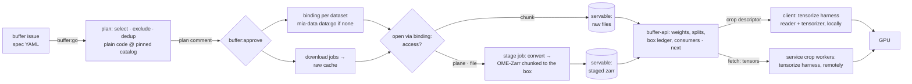

# MIA training buffers: spec → datasets → raw cache → crops served on demand — Spec

**Status:** draft v0.3 · 2026-10-23 · architecture only, not yet approved. v0.1 (commit `35f388e`) pre-tensorised
shards into a disk window; v0.2 (uncommitted, superseded) emitted miao configs over an OME-Zarr corpus. v0.3 follows
the ML lead's flow: download raw data, serve crops on demand straight from it where its chunking allows, stage to
OME-Zarr only where it does not, and let one service choose every crop by the spec's rules. The v0.1 diagrams at
[MIA Training Buffers](https://claude.ai/artifact/NpL68fp7iVfpQ9EWApz6oj) are stale except figures 1, 2 and 6 in
outline.
**Inputs:** the spec instance
[`examples/spec-microscopy-pretrain.yaml`](https://github.com/AI-HHMI/mia-agentic-search/blob/main/examples/spec-microscopy-pretrain.yaml);
[AI-HHMI/miao](https://github.com/AI-HHMI/miao) as a reference for resampling, normalisation and the batch contract
(not used as-is); the catalog record schema (`technical.arrays[]` with formats, axes, shapes, chunking);
mia-data's snippet interface (crops-spec §5.2), whose `Array.access ∈ {chunk, plane, file}` is the decision this
design turns on.
**Repos:** this repo (new package `mia_buffers/`, new service `buffer-api`, client library), a buffer issue repo
(working name `JaneliaSciComp/mia-workflow-buffers`), `JaneliaSciComp/mia-workflow-data` (dataset issues → approved
reader bindings), `JaneliaSciComp/mia-snippets` (reader snippets, harness), `AI-HHMI/mia-agentic-search` (catalog,
read-only).

## 0. Summary

A buffer specification filed as an issue becomes a **data pool** (the datasets it draws from, chosen by plain-code
filtering over the catalog at a pinned commit), then a **raw data cache** of those datasets' original files on
shared storage, then a **buffer service** that hands out crops to training clients, chosen according to the
spec's weighting, splits and no-repeat rules. Each crop is read either **directly from the raw files**, when their
layout lets a box be read cheaply, or from a **staged OME-Zarr copy** written once by a conversion job for data
whose layout does not. After staging, the two paths are the same path. Two kinds of **snippet** are pluggable,
**readers** (format → array) and **tensorizers** (array window → GPU-ready tensors), and fixed, human-owned
**harnesses** compose them: `tensorize` runs a reader and a tensorizer with parameters and yields a tensor;
`stage` runs a reader and writes OME-Zarr. The `tensorize` harness runs either in the service (remote tensors) or
in the client (local tensors from a crop descriptor). Both delivery modes are built; the service is required in
either, because it owns crop selection.

## 1. Lifecycle of a buffer issue

One `buffer:*` label at a time, set by the worker. Humans add `buffer:go`, `buffer:approve`, `buffer:keep`,
`buffer:retire`.

| stage | what runs | leaves when |
|---|---|---|
| `new` | | `buffer:go` |
| `planning` | resolve: `select`/`exclude`/`dedup` over catalog records at `catalog.ref`; availability of a reader binding per dataset and of a tensorizer for the spec's `sampling` block; bytes to download; weighting preview; split assignment | plan comment → `plan-review`; invalid spec → `needs-human` |
| `plan-review` | | `buffer:approve` → `sourcing`; spec edited + `buffer:go` → `planning` |
| `sourcing` | once per buffer: `snippets:go` in mia-snippets if no tensorizer matches, wait for the merge. Per dataset, in parallel: `data:go` on its mia-data issue if no approved binding; download job into the raw cache; path decision; stage job if needed; recipe written. Each dataset becomes **servable** independently | servable fraction per weighting group ≥ `ready.min_fraction` (default 1.0; a spec may lower it) → `ready`; a group with no servable dataset after `sourcing.dataset_timeout_days` → `needs-human` |
| `ready` | service serves; remaining datasets keep sourcing and join when servable; weights renormalise over the servable set | no consumer for `idle.hours` → `idle` |
| `idle` | nothing | `buffer:keep` → `ready`; `retire_after_days` or `buffer:retire` → `retired` (announced on the issue first) |
| `retired` | staged zarr deleted; raw cache entries released (deleted when no live buffer references them) | `buffer:go` starts a new round |
| `needs-human` | the comment says why | `buffer:go` |

Signal dedup, submit-once-by-key jobs, continue-as-new, the poller and the record-vs-live-view split are v0.1 §9
unchanged: Temporal holds the lifecycle and job ids, the filesystem holds the caches, the service holds sampling
state and consumers.

## 2. The four questions

**Where does dataset filtering happen?** At two times, in two places, both plain code.
- *Plan time, worker:* `select.where`, `exclude` and `dedup` over catalog records at the pinned commit decide the
  **data pool**: the datasets this buffer draws from. Every record appears in `plan.json` with the rule that admitted
  or excluded it, and the plan comment shows that table. No agent.
- *Serving time, `buffer-api`:* the spec's `weighting` (temperature over the `over` hierarchy), `splits`
  (a consumer declares its split; volumes are assigned once from the seed) and the no-repeat rule (a ledger of boxes
  drawn per volume, with the overlap limit) decide **each crop**. The service is the only sampler, so two
  consumers of one buffer see one distribution and one ledger. Weights renormalise over servable volumes as
  datasets arrive, and the `next` response says which groups are under-represented so far.

**Where does reading happen?** In whoever tensorises: the service's crop workers (remote mode) or the client
library (local mode). Both read from shared storage through the same harness code and one of two readers:
- *Direct:* the dataset's approved **reader snippet** with its binding opens the raw files in the cache and reads
  the box (`Array.read(region)`). Used when the opened array reports `access: chunk` and the stored chunk is not
  much larger than the box (`direct.max_chunk_to_box_ratio`); also for `plane` when the spec's box is planar.
- *Staged:* a built-in OME-Zarr reader opens the staged copy. Any volume whose array reports `plane` or `file`
  access, or whose chunks are too coarse, is converted once by a **stage job** (reader snippet → OME-NGFF
  multiscale zarr, chunked to the spec's box, label layers alongside), after which it is read like any other
  chunked source. Staging is a property of (volume, spec box), decided by code, re-decided per round.
Datasets published as zarr, n5, chunked HDF5 or tiled TIFF mostly take the direct path; zips of PNG slices, MRC
stacks and single huge TIFFs take the staged one.

**Where is raw data cached?** `raw_root/<record-id>/` on large shared storage: the original files, downloaded by
plain jobs from the record's URLs (or the binding's file list), checksummed against the record's validators,
resumable, byte-capped. Shared across buffers and reference-counted; a dataset is downloaded once however many
specs want it. `staged_root/<record-id>/<volume>-<box-key>.zarr` sits beside it for the staged path. Both are
regenerable, so neither needs backup; `state_dir` (specs, plans, ledgers, service database) does. The spec's
`cache` block (node-local disk, prefetch depth, workers) is the client library's local prefetch of crops it has
been promised by `next`; it is in scope for the local-mode client, not for the service.

**What needs code snippets?** Two kinds, composed by harnesses (§4).
- **Reader snippets**, one per format and layout: `open_array(src, io) → Array` with lazy `read(region)`. Both
  paths use them: the direct path reads boxes through them, the stage job reads whole arrays through them. They
  come from mia-data exactly as today (match, develop via autodev, human approval of preview crops, `data:done`
  binding). The built-in OME-Zarr reader is a reader snippet like any other, so a staged volume composes identically.
- **Tensorizer snippets**, one per output convention: `tensorize(patch, params) → Tensors`, pure, declared shapes
  and dtypes, no I/O. They implement the spec's `sampling` vocabulary (resample, normalise, cast, axis order, label
  encoding, emitted metadata); a spec whose tensor demands no existing tensorizer describes goes through the
  develop path (a `snippets:go` issue that autodev turns into a `tensorizers/<name>/` PR, tested on real patches,
  merged by a human), exactly as readers do.
Harnesses, samplers and the service are not pluggable: they are the human-owned code every crop goes through.

## 3. Sourcing a dataset

For each dataset in the data pool, three independent activities run under the one workflow, each submit-once by key:

1. **Binding.** Read `<dataset folder>/binding.yaml` written by mia-data's publication (a small mia-data change,
   §6). If the dataset issue is not `data:done`, add `data:go` (the buffer bot is a trusted labeler) and wait on the
   poller's `dataset_update`. Timeout or `data:ineligible` drops the dataset and re-posts the plan.
2. **Download.** A plain job fetches the binding's files into `raw_root/<record-id>/` with the harness `io` (hosts
   limited to the dataset's, validators recorded, CRCs checked, resumable per file). The job writes
   `files.json`: url, path, size, validators. Large datasets stream to the cache over several jobs under
   `limits.job_bytes`.
3. **Path decision and staging.** `harness probe <binding> --box <spec box>` opens every array through the snippet
   with the cache mounted read-only and reports per volume: axes, shape, dtype, voxel size, `access`, chunk shape,
   decision `direct` or `stage` with the reason. Volumes decided `stage` get a stage job each: `harness stage` reads
   the array through the snippet and writes OME-NGFF zarr at `staged_root/…`, chunked to the box, with a
   verification pass (shape, dtype, checksum of a sample of chunks against a fresh read through the snippet). The
   stage job runs reviewed code only and mounts the raw cache read-only; it writes to `staged_root` only.

The sourcing step also writes the dataset's **recipe** (§4): binding, the tensorizer matched to the spec's
`sampling` block with its params, and the harness pin. A volume is **servable** when it has a recipe and either
(`direct` and its files are downloaded) or (`stage` and its zarr is verified). The worker registers servable
volumes with the service (`PUT volumes`), with their weights and split, and the service begins drawing from them.

## 4. Snippets and harnesses: composition

Snippets are small, immutable, independently approved units; harnesses are the fixed programs that compose them.
Every harness takes a **recipe**: the frozen tuple (reader binding, tensorizer name + params, harness pin) written
per (dataset, spec) at sourcing time and referenced by every crop descriptor.

| harness | composes | in → out | runs in |
|---|---|---|---|
| `probe` | reader | binding + spec box → per-volume axes, shape, dtype, voxel size, `access`, chunking, `direct`/`stage` decision | sourcing job |
| `stage` | reader → writer | binding → OME-Zarr multiscale chunked to the box, label layers alongside, verified by re-reading a sample of chunks through the reader | stage job |
| `tensorize` | reader + tensorizer | recipe + crop descriptor (volume, box) → `Tensors` in the batch contract (`img`, `label`, `bbox`, `pixel_size`, `meta`) | service crop worker (remote) or client library (local) |
| `crop` | reader → PNG preview | mia-data's existing test crops for human review of a binding | mia-data jobs, unchanged |
| `test-tensorizer` | reader + tensorizer on a PR head | real patches from an approved dataset → pass/fail against `describe()` | autodev test job, private cache |

The tensorizer owns everything between the array window and the GPU: resample to `target_voxel_size` (linear
images, nearest labels), normalise (`scope: patch` from the window; `scope: volume|dataset` from statistics the
sourcing step computed once and stored with the volume), cast to `dtype`, order to `output_axes` with
`missing_axes`, prepend the label axis when a label layer is present, emit `bbox`, `voxel_size` and the `metadata`
fields the recipe carries. The harness owns the window read (box plus the tensorizer's declared margin), the
contract check (shapes and dtypes exactly as `describe()` declared) and provenance. miao's resampling and
normalisation code is the reference to borrow from for the first tensorizers; its batch contract is the one to
match so mia-train's wrapper needs little change.

Composition is by data, not by import: a tensorizer never imports a reader, a reader never imports a tensorizer,
neither imports the harness beyond its API module. The same `tensorize` harness runs in both delivery modes; the
only difference is who calls it.

## 5. The buffer service and the client

`buffer-api` is one HTTP service per deployment, reachable inside the cluster network, with a SQLite ledger under
`state_dir` and the caches mounted read-only. It holds no credentials and deletes nothing.

| call | who | effect |
|---|---|---|
| `PUT buffers/<id>` | worker | spec hash, weighting rules, split assignment, seed, ready threshold |
| `PUT buffers/<id>/volumes/<vol>` | worker | a servable volume: reader (`direct` binding ref or `staged` zarr path), shape, voxel size, label layers, weight, split, statistics |
| `POST buffers/<id>/consumers` | client | register `{name, host, pid, split, mode}` → `consumer_id`; heartbeat every `consumers.heartbeat_s` |
| `GET buffers/<id>/next?n=` | client | the next `n` **crop descriptors** for this consumer's split: volume, box, recipe id, seq. Drawn by weight over servable volumes, box uniform in the volume, overlap ≤ limit against the ledger, recorded in the ledger before returning. `204` + `Retry-After` when nothing is servable yet |
| `GET crops/<seq>` | client, remote mode | the tensors for a descriptor (safetensors body), produced by a service crop worker running the `tensorize` harness |
| `GET buffers/<id>/status` | anyone | servable fraction per group, draws per group vs target, consumers, underrun |

**Local mode:** the client library reads the descriptor's box itself from shared storage (direct through the
snippet's reviewed code at the pinned commit, or staged through the zarr reader), tensorises, and prefetches the
next descriptors into the spec's node-local cache. No bytes cross the service. **Remote mode:** the client only
calls `next` and `crops`; the service's crop workers (a pool on the service host, or csub jobs it drives) do the
reading. Remote mode is for clients that cannot mount the caches or run the harness environment; local mode is the
default for cluster training jobs. The descriptor is the same object either way, so a run can be reproduced from
the ledger alone.

`BufferDataset(url, buffer, split, mode)` is an iterable torch dataset: registers, heartbeats, pulls descriptors,
yields samples in miao's batch contract. One consumer per process; rank-aware by registering per rank.

## 6. Changes to existing code

1. **mia-data publication writes the approved binding** to `<dataset folder>/binding.yaml` with its sha256 in the
   manifest (wire-format rule: new field with a default). Buffers read bindings from there, never from comments.
2. **mia-data trusts the buffer bot** for `data:go`.
3. **mia-snippets** gains `tensorizers/<name>/` (same CI rules as `snippets/`: one new directory per PR, no
   edits), the harness API types `Patch`, `TensorSpec`, `Tensors`, the harnesses `probe`, `stage`, `tensorize`,
   `test-tensorizer` (§4), and a built-in OME-Zarr reader satisfying the `Array` protocol. Reader snippets are
   unchanged. autodev's `snippets` deployment accepts tensorizer issues: its prompt names both directories and
   `required_checks` gains `mia-buffers/tensors`.
4. **`mia_buffers/`**: `specmap`, `select`, `plan` (weights, splits), activities (binding, download, probe, stage,
   register volumes, service calls), `MiaBuffer`, `MiaBufferPoll`, CLI (`mia-buffers plan <spec>` offline;
   `mia-buffers source <dataset>` drives one dataset by hand), the `buffer-api` service, the client library.
5. **`mia_ops`**: app kinds `mia-buffers` (worker + broker; caches read-write) and `buffer-api` (listening
   service; caches read-only).

## 7. Trust boundaries

Crops-spec §9 and v0.1 §10 hold. Downloaded files are untrusted bytes read only by reviewed snippet code in
sandboxes or by the built-in zarr reader. The stage job and the service's crop workers run reviewed code at pinned
commits; the match agent and PR-head test jobs never see the shared raw cache read-write. Consumers are untrusted:
they can register, heartbeat, pull descriptors and fetch tensors for descriptors they were given; they cannot
influence selection beyond declaring a split. The spec is untrusted text, safe-loaded and schema-validated;
every record id and URL in the plan is re-read from the catalog, never taken from the spec.

## 8. Flags for the ML side

1. **Fields the record schema lacks** for `select.where`: `sample_type`, `content_hash` for `dedup`,
   `annotations.encoding` (lives in `technical.arrays[]`), `auto-predict` vs the schema's `automatic`,
   `min_size_voxels` (derived). Grow the schema or let `specmap` document the approximation in the plan comment.
2. **Chunking is the hinge.** The path decision needs `technical.arrays[].chunks` (or a probe) per volume; the
   enricher should record chunk shape for chunked formats so the plan can estimate staging volume before download.
3. **Normalise `modality` to families** (the catalog's `tools/readiness.py` `FAMILIES`) for `weighting.over` and
   `normalize.scope: dataset`; reuse that mapping.
4. **`label_axis: l`** and miao's `l` (scale levels) collide if the contract is kept miao-shaped. Pick a letter.
5. **Remote vs local tensorisation** is both here; decide which the first training runs use so the first
   milestone builds the right half first (§10 assumes local).

## 9. Open questions (defaults in bold)

1. **Where buffer issues live:** **new repo**, or a label family in mia-workflow-data.
2. **Direct-path threshold:** **chunk volume ≤ 8× box volume**, else stage; tune after measuring read amplification
   on real zarr/n5/tiled TIFF datasets.
3. **Service placement and crop workers for remote mode:** **service host pool, cluster-internal, self-identified
   consumers**; csub-driven workers and SSO if remote mode becomes the norm or leaves one group.
4. **Raw cache retention:** **reference-counted by live buffers, deleted on last retire**, with a root quota that
   queues sourcing (v0.1's admission rule) when exceeded.
5. **Reproducibility of a run:** **the ledger is the record** (seq → descriptor); replaying a run means replaying
   descriptors, not re-sampling.

## 10. Build order

| # | milestone | done when |
|---|---|---|
| 0 | `specmap` + `select` offline over a catalog snapshot | the example spec yields a record table with a rule per record; schema violations refused with the validator's message |
| 1 | harness API + `probe`, `stage`, `tensorize`, OME-Zarr reader; two hand-written tensorizers; one `direct` dataset (zarr/n5) and one `stage` dataset (tiff zip) | both volumes yield identical tensors for the same recipe and descriptor through both readers; stage output verifies; a tensorizer's output mismatching `describe()` fails the harness |
| 2 | `buffer-api` + local-mode client against hand-registered volumes | a one-GPU smoke job trains on crops from both datasets with the spec's weights; two consumers share one ledger; a killed consumer costs a delay only |
| 3 | `MiaBuffer`/`MiaBufferPoll`: go → plan → approve → sourcing (download, probe, stage, register) → ready, with datasets already `data:done` | an issue reaches `buffer:ready` progressively as datasets become servable; a redelivered `go` does nothing |
| 4 | sourcing through mia-data (`data:go`), binding publication, statistics for `normalize.scope: volume/dataset` | a spec naming an unmatched dataset reaches ready after the human approval on the dataset issue |
| 5 | remote mode: service crop workers, `GET crops/<seq>` | a client with no cache mount trains from tensors over HTTP |
| 6 | retire, reference-counted caches, root quota, operations (`status`, `check`) | an idle buffer is retired with notice; a shared dataset survives; a full root queues sourcing with a comment |
