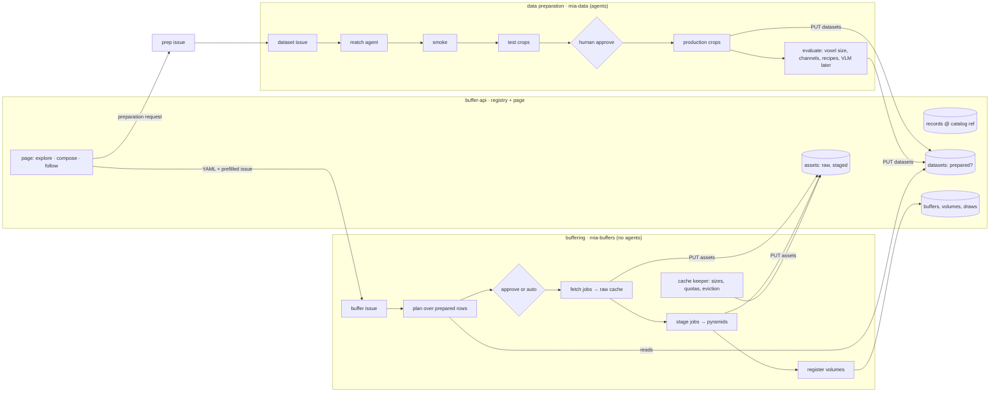

# MIA: data preparation and buffering as two pipelines around one registry — Spec

**Status:** draft v0.2 · 2026-10-25 · architecture, not yet approved. v0.2 takes the architecture review of
`ae37969` (`mia-client-test/notes/2026-10-25-training-buffers-architecture-review.md`): immutable staged
artifacts (§1.10, §5.2), the service's state on host-local disk (§1.11, §3), a worker token on mutating routes
(§1.12, §7), "the plan decides, registration applies" (§1.13, §5.7), recipe pins in the buffer config (§5.7), a
`mia_core` package for what both applications share (§8), and cache coordination by lock files in a host-local
directory instead of leases in the API (§1.7, §5.5). Builds on the training-buffers spec
([`2026-10-21-training-buffers.md`](2026-10-21-training-buffers.md), v0.7, milestones 0–4 built on branch
`training-buffers`) and the mia-data crops spec ([`../mia-crops-spec.md`](../mia-crops-spec.md)). This document
changes how those two systems meet; it does not re-describe what they do inside.
**Repos:** this repo (`mia_data/`, `mia_buffers/`, `mia_ops/`, `autodev/`), mia-snippets (harness:
`fetch`), the issue repos `JaneliaSciComp/mia-workflow-data` (datasets) and `JaneliaSciComp/mia-buffers`
(buffers and preparation requests), the catalog `AI-HHMI/mia-agentic-search` (read-only).

## 0. Summary

Two pipelines, one registry, one web page.

- **Data preparation** (mia-data, agentic): a catalog record becomes a dataset that is **good to go**: an approved
  reader binding, published crops a human looked at, and an evaluation of what the catalog did not say (voxel size,
  channel meaning, gray and RGB recipes, later a VLM verdict on the previews). Every outcome lands in the
  **registry** as the dataset's row.
- **Buffering** (mia-buffers, agent-free): a spec selects from the **prepared** rows only, a human approves (or the
  spec says it does not need to), and a reconciler brings the caches to the plan: raw files into the shared raw
  cache, then one NGFF pyramid per volume, then registration with the sampler. It watches servable coverage against
  the plan and disk against quotas. It never asks an agent anything and never kicks preparation off by itself.
- **The registry and the page** live in buffer-api: one SQLite file on the service host's local disk holding
  catalog facts at synced commits, dataset preparation state, cache assets (what is on disk, how big, who uses
  it, who is fetching it), buffers and their use. The page is the pool explorer made live: filter the catalog by spec fields, see what is prepared,
  cached and in use, take the YAML, open the buffer or the preparation request, follow it.
- **Configuration** is one `mia.yaml`: shared sections once, a block per service holding only what differs.



## 1. Where this pushes back

Read this first; everything after assumes these calls.

1. **The buffering pipeline is already agent-free.** Planning is plain code over the catalog, sourcing is jobs,
   the only agents in the whole system are mia-data's match step and autodev's snippet and tensorizer
   development. The coupling that makes buffering *feel* agentic is that a buffer plan, finding no binding for a
   dataset, adds `data:go` on the dataset issue and waits up to 14 days for mia-data. This spec removes that:
   a buffer plans over prepared datasets only, and asking for preparation is a separate, explicit action (§4.4).
   The `waiting-dataset` state, the `dataset_update` signal, the poller's binding watch and the timeout drops
   go with it.
2. **"The database" is buffer-api's registry, and it is an index, not the truth.** The same principle the
   ledger already follows: files on disk (`binding.yaml`, `manifest.json`, `evaluation.yaml`, `stage.json`,
   `files.json`) and Temporal histories are authoritative; every registry table is rebuildable from them by a
   `sync` command. A second database beside the ledger would be the same data twice. Nothing else changes about
   buffer-api's nature: it deletes nothing and holds no credentials.
3. **The page composes and observes; GitHub still authorises.** buffer-api has no notion of who is calling and
   runs on the cluster network. A button that starts a buffer, requests preparation or retires data would let
   anyone on that network spend cluster time, bandwidth and disk under the bot's identity. Today the gate is a
   GitHub label from an account with write access, checked by the poller. So the page builds the YAML and opens a
   **prefilled new-issue link** (`https://github.com/<repo>/issues/new?title=…&body=…`, no credentials needed, the
   user is logged in); the poller picks the issue up exactly as now, and the page follows it from there. The only
   click that leaves the page is the one that needs an identity. When the service gets an identity layer (SSO
   proxy, header auth), the same buttons can call the API directly; the design does not block that (§7).
4. **"Pre-caching the crops" means staging pyramids.** In local mode no crop is stored: the sampler hands out
   descriptors and the client reads the pyramid. The pyramid is the crop cache. A window of pre-tensorised
   crops is remote mode (training-buffers §10 milestone 6) and is not in this spec.
5. **A buffer cannot "go dry"; its coverage and its disks can go wrong.** Train is an infinite stream over
   staged volumes; nothing is consumed. What can fail: too few volumes servable (plan vs servable per weighting
   group), a pyramid or raw file that vanished under a live buffer, consumers getting `204`, a root over quota, a
   fetch that cannot proceed. So "monitor the buffer" is a reconciler: desired = the plan, floor =
   `ready.min_fraction`, ceiling = the quotas, and the actions are fetch, stage, register, evict (§5).
6. **Fetch and stage are two phases per dataset, not two global phases.** Fetching everything before staging
   anything makes every buffer wait for its slowest download. Staging uses no network once the files are cached,
   so staging dataset A while B downloads costs nothing and reaches `ready` sooner. Two parallelism knobs, a
   weight-ordered queue (heaviest datasets first), and the global order falls out when bandwidth is the bottleneck.
7. **The lock is a file in a host-local directory, taken by workers, never by jobs.** The caches live on NFS,
   where file locks do not work, so nothing coordinates through the shared filesystem. Both workers run on one
   host (that is what `mia up` does), so a directory on that host's local disk, mounted read-write into both
   worker sandboxes like the broker's socket directory already is, gives a correct lock with no service in the
   path. Every job that mounts a record's raw cache read-write (mia-data's smoke and trusted crop jobs, the
   fetch job, the stage job) is submitted only after its worker holds `<local_root>/locks/raw/<record>`, and the
   lock is released when the job ends. One writer per record at a time, across both pipelines and any number of
   buffers; a worker that finds the lock held waits and retries. The per-record serialisation also fixes a bug
   that exists today: `files.json` is rewritten read-modify-write, so two jobs writing one record's cache at once
   lose entries. The lock is a file created with `O_EXCL`, not an `flock`: it has to outlive activity invocations
   and a worker restart while the job keeps running, so it carries its owner and a heartbeat and goes stale by
   age (§5.5). The constraint is **one host for the two workers**; if they ever run on different hosts, the
   lock directory is replaced by a lease table in the registry, which is the design this version had before and
   is kept in §5.5 as the upgrade path. `archive_snapshot`'s `fcntl` lock on `work_root` has the same NFS
   problem and moves to the same directory.
8. **The plan runs once, on the server.** The pool explorer re-implements the planner's rules in JavaScript; two
   copies drift. The live page posts the spec draft to the service and renders the real `build_plan` result over
   the registry's records. Charts and the funnel are just views of plan rows.
9. **Keep the GitHub issue as the record of a buffer and a preparation request.** It carries identity, the spec
   text, approval and a durable log that outlives the SQLite file. The page shows the same information faster and
   across issues; it does not replace them. If the group later wants buffers without issues, the identity layer in
   §7 is the prerequisite, not a UI change.

The architecture review of 2026-10-25 added four calls that are cheap now and expensive once data is served:

10. **A staged pyramid is an immutable artifact with an identity.** Today the staged directory is
    `<levels key>/<record>`, and reuse checks only the binding hash. Two buffers wanting the same record stage
    into one directory, and a later binding rebuilds under a buffer that is serving from it. From now on an
    **artifact id** is the hash of every input that changes the bytes (binding hash, levels key, voxel size,
    harness commit and environment digest), the directory is `<levels key>/<record>/<artifact id>`, it is
    written to a temporary name and renamed by the worker after verification, and it is never modified. Buffers
    and the registry refer to artifact ids, not to records (§5.2). Weights, splits and readiness thresholds are
    not part of the identity; they belong to the buffer.
11. **The service's state lives on host-local disk.** SQLite relies on the same POSIX locks that do not work on
    NFS, and WAL needs same-host shared memory. The state dir of buffer-api moves to `<local_root>/service/` on
    the service host (`/scratch`-class local disk), with an hourly `.backup` copy under the shared `state_root`
    (§3, §8). The lock directory of §1.7 is the sibling `<local_root>/locks/`.
12. **Mutating routes need a worker token.** The consumer routes stay open as the training-buffers spec has
    them; everything that writes buffers, volumes, assets, datasets or events requires a bearer token both
    workers read from a file named in the configuration. The page stays read-only and needs no token; the
    GitHub links are its only actions. This is a capability split inside one service, not a user identity
    layer, which stays out of scope (§7).
13. **The plan decides, registration applies.** Today registration re-derives splits from the spec: a holdout
    dataset the plan marks all-test is re-split by the ordinary fractions, and from `sampling.seed` rather than
    `splits.seed`. From now on the plan row carries the split policy and registration consumes rows, never the
    spec; the buffer config carries the recipe pin (tensorizer, params, harness commit, environment digest) and
    the client checks its checkout against it (§5.7).

## 2. Goals, non-goals, anti-goals

**Goals.** A dataset is prepared once and the fact is queryable. A buffer is planned from prepared datasets in
seconds, on a page, and from the same code the worker runs. Raw files are downloaded once however many pipelines
and buffers want them, never twice at the same time. Everything on disk under the roots is known: size, origin,
users, last use. One place shows what is prepared, what is cached, what is buffering, what was buffered and how it
was consumed. One configuration file.

**Non-goals.** Catalog discovery and enrichment (mia-agentic-search's harvesters); the evaluation agent's prompt
and the VLM check (the hook and the row schema are here, the agent is its own plan); remote mode; user identity
on buffer-api (a worker token is in scope, §1.12; knowing which person is calling is not); replacing GitHub
issues; a job scheduler of our own (csub and LSF stay); running the two workers on different hosts (§1.7).

**Anti-goals.** A second source of truth that disagrees with the files. A service that must be up for a job to
run (jobs never call the service; workers do, and tolerate it being down for status writes). Agents in the
buffering path. Deleting data from the service process.

## 3. The registry

One SQLite file, `<local_root>/service/buffers.sqlite`, on the service host's local disk, owned by buffer-api,
WAL mode, one process. The service refuses to start when that path is on a network filesystem (`statfs` magic
for NFS, CIFS, Lustre), and copies the file with `sqlite3`'s online backup to `<state_root>/mia-buffers/backups/`
every `keeper.minutes`, keeping the last 48; a restore is a file copy. The existing tables (`buffers`,
`volumes`, `consumers`, `draws`, `frozen`, `assets`, `refs`) stay; `assets` gains columns, and five tables join
them. Workers write through HTTP; the page reads through HTTP; nothing else opens the file. A volume's row and
its two `refs` rows are written in one transaction, so a reference never exists without its volume or the
other way round.

| table | key | holds | written by | rebuilt by |
|---|---|---|---|---|
| `catalogs` | `ref` | a synced catalog commit: `synced_at`, record count | `mia-buffers catalog sync` | the catalog mirror |
| `records` | `(ref, id)` | the planner's `Facts` for the record as JSON (what `specmap.facts` returns: dims, modality, family, organism, licence, annotations, arrays with shapes and dtypes, voxel size, bytes, download method, hosts, DOI) plus `path` and `title` | `catalog sync` | the catalog at `ref` |
| `datasets` | `id` | preparation state: `state` (`unprepared` is the absence of a row · `in-progress` · `prepared` · `ineligible` · `needs-human`), `data_stage` (mia-data's `data:<stage>`), `issue`, `folder`, `binding_hash`, `binding_commit` (snippets commit), `published_at`, `crops` (count), `evaluation` (JSON, §4.3, null until evaluated), `updated_at` | mia-data's `set_stage` and `publish_crops` activities (best effort), `mia-buffers datasets sync` | `storage_root/<folder>/{binding.yaml, manifest.json, evaluation.yaml}` and the datasets repo's labels |
| `assets` | `(kind, key)` | `raw`: key = record → files from `files.json`; `staged`: key = **artifact id** (§1.10) → `record`, `levels_key`, `path`, `binding_hash`, `harness_commit`, `env_digest`, `voxel_size_nm`, stage facts; both: `state` (`fetching` · `staging` · `waiting-drop` · `ready` · `partial` · `missing` · `evicted`), `bytes`, `job` (csub job id while a job builds it), `last_used`, `scanned_at` | the workers after every job that touched the cache; the keeper's scan | the roots: `files.json`, `stage.json` (which records the artifact's inputs), directory sizes |
| `refs` | `(buffer, kind, key)` | as now, keyed by artifact id for `staged`; written with the volume in one transaction; removed on retire | the buffers worker | the ledger's volumes |
| `buffer_datasets` | `(buffer, record)` | the per-dataset status the workflow holds today (`pending` · `fetching` · `waiting-drop` · `staging` · `servable` · `failed` · `skipped`), `reason`, `job`, `updated_at` | the buffers worker on every change | the workflow's `status` query |
| `buffer_events` | `(buffer, seq)` | `created`, `planned`, `approved`, `ready`, `idle`, `retired`, `needs-human`, with time, issue, event id and a short detail | the buffers worker | the issue's comments |
| `usage` | `(buffer, day)` | draws, distinct consumers, bytes of pyramid read is unknown (local mode), `204` responses | buffer-api itself, rolled up from `draws` once a day and on retire | `draws` |

Rules:

- **Writers tolerate absence.** A worker's registry write is one HTTP call with a 30 s timeout; on failure it
  logs and continues, except the writes the workflow depends on (`create_buffer`, `register_dataset`, asset
  reuse lookups), which retry as activities do today.
- **Sync commands make the index honest, and the service runs only the ones that need no credentials.**
  `mia-buffers catalog sync [--ref SHA]` (default: the catalog's `main` head) archives the catalog as
  `catalog_snapshot` does today (git mirror under the worker's `state_dir`, GitHub token) and loads `records`
  through `PUT /records/<ref>`; it is a worker or CLI operation, never the service's. `mia-buffers datasets sync`
  walks `storage_root` only (`binding.yaml`, `manifest.json`, `evaluation.yaml`); the `in-progress` states come
  from mia-data's own writes (§4.1), not from a label scan, so this sync needs no GitHub either. `mia-buffers
  assets sync` walks `raw_root` and `staged_root`. The service can therefore run the datasets and assets syncs
  itself (`POST /sync/datasets`, `POST /sync/assets`, one in flight at a time) because it only needs the roots,
  which `mia-buffers serve` now learns from the shared configuration (§8; it reads `paths` and `service`, never
  `github`). The keeper (§5.4) runs `catalog sync` of the catalog's `main` head every `keeper.catalog_sync_hours`
  (default 24) and the two cheap syncs every pass, so the page has nothing to trigger; `POST /plan` for a ref
  that is not synced answers `409` naming the command, and the page always defaults to the newest synced ref so
  it never hits that.
- **Draws are kept per buffer until retire**, then exported to `<state_root>/mia-buffers/archive/<buffer>.draws.jsonl.gz` (shared storage, beside the backups)
  (the reproducibility record, training-buffers §9.5) and deleted from the table; `usage` keeps the daily counts
  forever. *My call; the alternative is to keep every draw in SQLite, which at 15 samples/s per consumer is
  about a million rows a day and makes `status` slow within weeks.*

### 3.1 API additions

Everything is JSON. Three capability levels, enforced per route: **consumer** routes (register a consumer,
`next`, `split`, `status`) are open as training-buffers §5 has them; **read** routes (every other `GET`) are
open to the page and anyone on the network; **worker** routes (every `PUT`, `POST`, `DELETE` other than the
consumer ones) require `Authorization: Bearer <token>`, the token being the content of `service.token_file`,
which both workers and the service read and nobody else (§7, §8). A missing or wrong token is `401` with no
detail.

| route | effect |
|---|---|
| `GET /records?ref=&…filters` | records at a catalog ref; `ref` defaults to the newest synced |
| `POST /plan` body `{spec: <yaml text>}` | runs `load_spec` + `build_plan` over `records` at the spec's `catalog.ref` joined with `datasets` and `assets`; returns the plan rows with three extra columns per row: `prepared` (state), `raw` (asset state and bytes), `staged` (levels keys present). A row that passes every spec rule but is not `prepared` is **out** with the rule `not prepared` |
| `PUT /datasets/<id>` · `GET /datasets[/<id>]` | preparation state; the PUT merges fields (a stage change sends only `data_stage` and `issue`) |
| `PUT /assets/<kind>/<key>` · `GET` (as now) | plus the new fields; `GET /assets?kind=&state=&record=` lists with totals per root; `GET /assets/staged?record=&levels_key=&binding_hash=&harness_commit=` is how `read_binding` asks whether this exact artifact exists |
| `GET /locks` | the lock files of `<local_root>/locks/` as the service sees them (it runs on the same host): kind, key, owner, taken, last heartbeat, stale or not; read-only, for the page |
| `PUT /buffers/<id>/datasets/<record>` · `GET /buffers/<id>/datasets` | per-dataset status board |
| `POST /buffers/<id>/events` · `GET /buffers/<id>/events` | lifecycle events |
| `DELETE /buffers/<id>/refs` | on retire: drop the buffer's refs, archive its draws to `<state_root>/mia-buffers/archive/` |
| `GET /buffers` | every buffer with its latest event, servable/total, active consumers, draws today |
| `GET /usage/<buffer>` | the daily rows |
| `PUT /records/<ref>` | the worker's `catalog sync` loads a ref's facts (one body, replaces the ref) |
| `POST /sync/datasets` · `POST /sync/assets` | runs that sync in a thread of the service; `409` while one runs; worker token (the keeper and the CLI call them) |
| `GET /` and `/ui/*` | the page (§6) |

`GET /buffers/<id>/status` additionally stats each volume's pyramid path (once per status call, not per draw) and
reports volumes whose path is gone as `missing`; `next` skips them. *My call: a lost pyramid should surface in the
page and in `ready`, not as client read errors.*

## 4. Data preparation

mia-data's round is unchanged in shape: seed, `data:go`, match agent, smoke, test crops, `data:review`,
`data:approve`, production crops, publication. Four additions.

### 4.1 The registry hears every stage

`set_stage` and `publish_crops` call `PUT /datasets/<record>` (best effort, §3). Publication sends `prepared`
with the binding hash, the snippets commit, the folder, the crop count and `published_at`; `ineligible` and
`needs-human` send their state; the in-between stages send `in-progress` with `data_stage`. The record id is
the trusted one from the issue marker, never from the record body. mia-data therefore reads `service.url` and
`service.token_file` from the shared configuration (§8) and uses the registry client in `mia_core/registry.py`
(§8), as mia-buffers does.

### 4.2 Readiness

A dataset is **prepared** when `storage_root/<folder>/binding.yaml` exists with a `manifest.json` whose
`binding.sha256` matches it. One function decides it, `mia_data.publish.prepared_row`: the worker's `read_binding`
and the registry's `datasets sync` both call it, so a `binding.yaml` placed by hand without crops is not prepared
anywhere, and the buffer opens the dataset's mia-data issue instead (before milestone B `read_binding` accepted a
bare `binding.yaml`; the registry row is the index of the same rule). `evaluation` is **not** required for `prepared` in this version: the planner falls back to the static
tables (`mia_buffers/assume.py`) when it is null and the plan row says so, as it does now. When the evaluation
step exists, a buffer spec may demand it (`select.where.evaluated: true`).

### 4.3 The evaluation step (hook only)

After production crops pass and before publication, a new optional job **evaluate** runs an agent with the
record, the binding, the smoke report, the production preview PNGs and the harness's `probe`-style facts, and
writes `evaluation.yaml` beside the binding:

```yaml
schema_version: 1
record: <id>
binding_sha256: <hash>
voxel_size_nm: {y: 45, x: 45}            # per axis, as the record says or as inferred
voxel_size_source: record | header | inferred
voxel_size_range_nm: {y: [30, 60], x: [30, 60]}   # when inferred
channels:                                 # per raw array
  - array: 0
    count: 3
    meaning: [EdU, gamma-H2AX, DAPI]
    gray: {op: channel, index: 2}        # the recipe vocabulary mia_harness.tensor_api.RECIPE_CHANNELS
    rgb: {op: rgb}
quality:                                  # the VLM check, later
  verdict: ok | suspect | bad
  notes: "..."
model: <model id>
at: <iso time>
```

`publish_crops` copies it beside the crops like the binding and the registry row carries it. The planner prefers
`evaluation.voxel_size_nm` and the recipes over the tables. Everything else about the agent (prompt, tools,
budget, how a `bad` verdict is surfaced on the issue) is a later plan; the mia-data config gains an
`evaluate.enabled: false` switch now so the round's shape is fixed.

### 4.4 Preparation requests

A new issue kind in the mia-buffers repo, label `prep:go`, body one ```` ```yaml ```` fence:

```yaml
schema_version: 1
kind: preparation
catalog: {repo: AI-HHMI/mia-agentic-search, ref: <sha>}
records: [<id>, <id>, …]                  # or the same `select` block a buffer spec takes
```

A small workflow `MiaPrep` (same poller, same label discipline) runs `nudge_dataset` for every record, as the
buffer workflow does today, posts one comment listing what it did (issue opened, `data:go` added, already in
progress, already prepared, ineligible), moves the issue to `prep:requested`, and closes with `prep:done` when the
registry shows every record out of `in-progress`, or `prep:needs-human` naming the rest after
`sourcing.dataset_timeout_days`. The page composes this issue from the explorer's current filter ("Request
preparation for the N unprepared records that pass this spec"). The existing `nudge_dataset`,
`DATA_IN_PROGRESS` logic and the trusted-bot `data:go` all stay; only their caller changes.

## 5. Buffering

The buffer issue and labels stay (`buffer:go`, `buffer:approve`, the `buffer:<stage>` stages, with `keep` and
`retire` added). The round changes inside.

### 5.1 Plan

`plan` reads `records` at `spec.catalog.ref` (synced on demand if missing, as `catalog_snapshot` does) and
`datasets`, and runs `build_plan` exactly as now with one more rule, applied after fit: **not prepared**. The
plan comment lists them under their own heading with a link to the page filtered to them, so the next action is
one click. `sourcing.unprepared: skip` is the only value in this version; the field exists so `request` can come
back if wanted. The spec gains `plan.auto_approve: false`; the page sets it true when the user has seen the
plan on the page, which is the same plan, so `plan-review` is skipped and sourcing starts on `go`. *My call: the
review step was there because the issue was the only place to see the plan.*

### 5.2 Sourcing as a reconciler

Per dataset of the pool, ordered by weight descending, with two semaphores (`sourcing.parallel_fetch`,
`sourcing.parallel`):

1. **Binding** from the registry row (`storage_root/<folder>/binding.yaml`, checked and copied into the round
   dir as today). Hosts not allowed to jobs, or `manual://` URLs → **waiting-drop**, the drop comment and the
   poller's `dropped` signal, unchanged, but the asset row says `waiting-drop` and the page shows the `incoming/`
   path.
2. **Fetch.** First decide the **artifact id** (§1.10) from the binding hash, the levels key, the plan row's
   voxel size and the round's harness pin, and ask the registry for it; an artifact that is `ready` and still on
   disk is reused with no job at all, and the dataset goes straight to step 4. Otherwise take the record's lock
   (§5.5); while it is held elsewhere, the dataset shows `waiting-lock` with the holder and the workflow sleeps
   `temporal.poll_minutes` between attempts. With the lock, re-read the assets (the holder may have fetched the
   raw files or built the very artifact) and, if the raw asset is `ready` for every URL of the binding, skip to
   step 3. Else check the raw quota (§5.4): the record's expected bytes (plan row, from the catalog's
   `bytes`, else unknown and allowed) against `quota.raw_bytes − Σ raw assets`; over quota → the dataset is
   **blocked**, the buffer comment and the page say by how much, and the reconciler retries after the keeper's
   next pass. Under quota → submit the **fetch job**: `harness fetch binding.yaml --record record.yaml --out
   fetch.json`, cache read-write, the binding's hosts, byte cap `limits.fetch_bytes`, walltime
   `limits.fetch_walltime_min` (a long-queue job by csub's walltime tables; it mounts only roots the policy
   already allows). It calls `io.fetch` for every URL (whole files; zip members fetch the zip once)
   and writes per-file outcomes. `partial` (cap or walltime hit) resubmits with the next
   attempt number up to `limits.fetch_attempts`; each attempt resumes from cache hits. The asset row goes
   `fetching` with the job id at submission and `ready` or `partial` from `fetch.json`. The lock is held
   across the attempts of one dataset's fetch and its stage, and released when the dataset is servable, failed or
   blocked.
3. **Stage** into the artifact's directory under a temporary name, `<levels key>/<record>/.building-<artifact
   id>-<job key>`; the stage job runs with the cache **read-only** again, as training-buffers §3 first intended:
   everything it needs is there, and a miss is a bug the job reports rather than a download. *Exception, my
   call: a URL the fetch step could not get as a whole file (no `Content-Length`, no range support, a store
   rather than a file) is listed in `fetch.json` as `stream`; the stage job of such a dataset keeps the cache
   read-write and the hosts allowed, as now.* `read_stage` verifies `stage.json` as today and, when it is `ok`,
   writes the artifact's inputs into it (`artifact: {id, binding_hash, levels_key, voxel_size_nm,
   harness_commit, env_digest}`) and **renames** the directory to `<artifact id>` (a directory rename is one
   operation on the shared filesystem; a reader never sees a half-built artifact). A job that fails leaves its
   `.building-*` directory for the keeper to remove after `quota.hold_hours`. The staged asset row goes
   `staging` → `ready` with bytes from `stage.json`. Published artifacts are never written again; a changed
   binding, harness or voxel size is a new id beside the old one, and the old one lives as long as a buffer
   references it.
4. **Register** every volume of the artifact with the volume body carrying `artifact` (the id) and its split
   assignment from the plan row (§5.7); the service writes the volume and its refs (`staged/<artifact id>`,
   `raw/<record>`) in one transaction; `buffer_datasets` row to `servable`.

`ready` when every weighting group meets `ready.min_fraction`; stragglers keep joining; the issue comment and
the page agree because both read the status board. The one buffer timeout (`sourcing.dataset_timeout_days`)
now applies to `waiting-drop` and `blocked` only.

### 5.3 Steady state: what the reconciler watches after ready

The buffer workflow sleeps between signals; the **keeper** (§5.4) watches on its schedule. For a `ready` buffer:

- a volume whose pyramid is `missing` → the volume is marked in the API (`next` skips it), the buffer's
  servable fraction drops; if a group falls under `ready.min_fraction` the keeper signals the buffer workflow
  `degraded(reason)`, which re-stages from the raw cache (the binding and recipe are pinned in the round dir)
  when the raw asset is `ready`, else goes `needs-human` with the reason;
- no consumer heartbeat for `idle.hours` (spec field, default 72) → `buffer:idle`, announced; `buffer:keep` →
  back to `ready`; `retire_after_days` (default 14) or `buffer:retire` → **retired**: `DELETE /buffers/<id>/refs`,
  the issue comment, the staged pyramids become evictable (refcount 0), raw stays until the keeper needs the space;
- `204` rate per consumer above a threshold (spec `health.max_empty_fraction`, default 0.05 over the last hour)
  is reported on the page and in `status`, not acted on: in local mode it means too few servable volumes for the
  split, which the coverage line already shows.

### 5.4 The cache keeper

A scheduled workflow `MiaCacheKeeper` (Temporal schedule beside the poller, every `keeper.minutes`, default 30)
running one activity, agent-free, under the buffers worker:

1. **Scan** `raw_root/<record>/` and `staged_root/<levels key>/<record>/<artifact id>/`: bytes (`os.scandir`
   sums; `du` is too slow at scale, so sizes are cached per asset and only directories with a newer mtime are
   re-summed), presence of `files.json` / `stage.json` (whose `artifact` block names the id, so an artifact
   built by hand or before the registry is still recognised), and `PUT /assets` for each; assets in the registry
   with no directory become `missing`; `.building-*` directories older than `quota.hold_hours` are removed.
2. **Quotas.** `quota.raw_bytes` and `quota.staged_bytes` in the configuration (per root; `0` = unlimited).
   Over quota, or under `quota.headroom_bytes` of it: **evict** assets that are **free**: `refs` empty, state
   `ready`, `last_used` older than `quota.hold_hours` (default 48), and for a raw asset no `datasets` row
   `in-progress` for its record (a mia-data round may be reading it). Oldest `last_used` first, staged before raw
   (raw is the expensive one to get back), until under quota minus headroom. Eviction is `shutil.rmtree` by the
   worker (never the service), the asset row goes `evicted` with the time, and a line goes to the keeper's log and
   to the page. An asset that is referenced, `fetching`, `staging` or held is never evicted; if the held set alone
   is over quota the keeper posts once on the newest buffer issue and the page shows the overrun. `last_used` for
   raw comes from the newest job that read it (mia-data's smoke and crop jobs and the stage and fetch jobs all
   end with the worker's `put_asset`, which touches it); for staged from `draws` (the service updates it hourly
   per volume's staged dir).
3. **Stale builds.** An asset `fetching` or `staging` whose job id csub reports finished or lost → `partial` or
   `missing`. The lock it was built under goes stale on its own (§5.5).

The keeper is also what `mia-buffers assets sync` runs by hand.

### 5.5 Locks, concretely

The rule: **no job writes a record's shared cache unless its worker holds the lock file
`<local_root>/locks/raw/<record>`.** The harness is unchanged; the discipline is in the two workers' job
submission, in one shared helper, `mia_core/locks.py`:

- `take(kind, key, owner, ttl_s) -> bool`: `os.open(path, O_CREAT | O_EXCL | O_WRONLY)` and write
  `{owner, taken_at, heartbeat_at, ttl_s}` as JSON; `False` when the file exists and its `heartbeat_at` is
  younger than its `ttl_s`. A stale file (heartbeat older than its TTL) is taken over by renaming it aside
  (`<name>.stale-<time>`, kept for the log) and creating anew; the rename is atomic on the local disk, so two
  takers of one stale lock cannot both win.
- `heartbeat(kind, key, owner)`: rewrite `heartbeat_at` through a temporary file and `os.replace`, only when the
  file still names this owner.
- `release(kind, key, owner)`: unlink, only when the file still names this owner.
- `holders() -> list`: what `GET /locks` shows.

Used by: mia-data before the smoke job and before a trusted crop job (`writable=True` in `jobspec`): take,
submit, heartbeat from `await_job`'s heartbeat (every 3 minutes; TTL 15 minutes), release after `read_*`; a PR
head's crop job and the match agent mount the cache read-only and need no lock. mia-buffers before the fetch
job, held through the stage job (§5.2). Both, for `snapshot/<sha>` around `archive_snapshot`'s fetch-and-extract,
replacing its `fcntl` lock. Waiting is a workflow timer loop (`take` → `False` → `workflow.sleep(poll_minutes)`
→ `take`), deterministic and visible: the owner string names the deployment, workflow and job key, so the page
and the issue comment can say "waiting for mia-data round i12-e345 on this record".

A worker restart while a job runs does not lose the lock: the file stays, `await_job` reattaches to the job and
its next heartbeat refreshes the file before the TTL. A worker that dies for good stops heartbeating and the lock
goes stale after 15 minutes, by which time csub has reported the job's end or will shortly. Hand-run harness
commands bypass this; the docs say to run them only on records no round is touching.

*Why not `flock`:* it is bound to an open file descriptor, so a worker restart would drop it under a running job.
*Why a local directory and not the registry:* no HTTP in the path of a job submission, mia-data keeps running when
buffer-api is down, and the mechanism is thirty lines of stdlib. *The constraint:* both workers must run on the
host that owns `<local_root>`; `mia up` already does that and `mia_ops` refuses a service whose `local_root` is on
a network filesystem. *The upgrade path* if the workers ever spread across hosts: the same four functions backed
by a `leases` table in the registry (`PUT /leases/<kind>/<key>` returning `200` or `409` with the holder, one SQL
statement under the ledger's lock) and the callers unchanged.

### 5.6 `harness fetch` and `fetch.json`

The harness change (`fetch`) is part of milestone C, made on mia-snippets' `training-buffers` branch like the
rest of this work; a buffer round pins the harness commit as today, so a round admitted before the change keeps
staging as it does now. The contract the worker reads, so both sides can be built against it:

```json
{"ok": true, "partial": false, "bytes_fetched": 123456789,
 "files": [{"url": "https://…/a.zip", "outcome": "fetched", "bytes": 123456789, "key": "<sha256>"},
           {"url": "https://…/b.tif", "outcome": "cached",  "bytes": 4567,      "key": "<sha256>"},
           {"url": "https://…/c.zarr/", "outcome": "stream", "reason": "no Content-Length"},
           {"url": "https://…/d.tif", "outcome": "failed", "reason": "HTTP 503"}],
 "errors": []}
```

`outcome` is `cached` (a hit, zero bytes), `fetched` (downloaded), `stream` (cannot be fetched as
a whole file; the stage job reads it as today, with the cache read-write and the host allowed) or `failed`.
`partial` is true when the byte cap or the walltime stopped the job before every URL was `cached`, `fetched` or
`stream`; `ok` is false only when a URL `failed`. A zip's members share the zip's one entry.

### 5.7 The plan decides, registration applies; the recipe is pinned

Two gaps the review found in the code as built, closed by one rule each.

**Splits.** `build_plan` already decides each pool row's split policy: a holdout record is all-test, the rest
follow `splits.fractions`. Registration ignores that and re-splits every volume's planes by the fractions,
seeded from `sampling.seed`. From now on the plan row carries `split: {policy: fractions | holdout, fractions,
seed}` with `seed` = `splits.seed`, `volume_bodies` reads the row and nothing else from the spec, and a
holdout volume registers with every plane in `test`. A spec option the planner cannot honour is an error in the
plan, never silently ignored (`splits.stratify_by` is the standing example: it is accepted today and does
nothing; it becomes a plan error until it is implemented). The buffer config records the plan's hash so a later
reader can tell which plan a registration applied.

**Recipe.** `BufferConfig` gains `recipe: {tensorizer, params, harness_commit, env_digest}` from the round's
pins, and every volume carries `artifact`. A descriptor is then fully determined by `(buffer, seq)`: the buffer
config names the code and parameters, the volume names the immutable bytes, the descriptor names the position.
`BufferDataset` reads the recipe from the buffer config and compares `harness_commit` with the checkout it was
given (`git rev-parse HEAD` of the `tensorizers` directory's repository, or the `MIA_HARNESS_COMMIT` the harness
environment exports); a mismatch raises unless `BufferDataset(..., allow_recipe_mismatch=True)`, in which case
it warns once and the sample's `meta` records the actual commit. The ledger's archive (§3) therefore reproduces
a run: the same checkout, the same artifacts, the same descriptors.

## 6. The page

Served by buffer-api from the package (`mia_buffers/ui/`): one HTML file, the explorer's layout and code, with
the embedded JSON replaced by `fetch` calls and the JavaScript planner replaced by `POST /plan`. No build step,
no framework, the same design tokens the explorer uses (light and dark). Four views, one top bar with the
catalog ref and when it was synced.

1. **Datasets** (the explorer, live). The filter row is the spec's fields as now, plus three toggles that are
   registry state: *prepared only*, *raw cached*, *staged for this geometry*. KPIs add prepared / in progress /
   unprepared counts for the current filter and the bytes the pool would download. The funnel gains the
   `not prepared` rule. The table gains columns: preparation state with a link to the dataset issue, raw cache
   state and bytes, staged levels keys, the buffers using it. Actions: **Download spec YAML** (the current
   controls serialised as a buffer spec: `select`, `sampling`, `splits` from the controls, defaults elsewhere,
   `catalog.ref` the page's ref, `plan.auto_approve: true`), **Open buffer issue** (the prefilled new-issue link
   for the buffers repo, title from the spec name, body the YAML fence; GitHub caps the URL at about 8 KB, so a
   long `exclude` list falls back to "copy YAML" with a notice), **Request preparation** (the prefilled `prep:go`
   issue listing the unprepared records of the current pool, with the same URL-length rule). The server-side plan
   is debounced at 300 ms; a plan over 1,940 records is expected under a second (to be measured; if it is not,
   the service keeps the parsed `Facts` per ref in memory, which is the only thing that costs).
2. **Buffers.** The list from `GET /buffers`; a buffer's page shows its events, the plan's pool with the
   status board (servable, fetching with job id, staging, blocked by quota, waiting for a drop with the
   `incoming/` path, failed with the reason), volumes with draws, consumers with last-seen, the daily usage
   sparkline, the spec YAML, links to the issue and the Fileglancer folders. A retired buffer shows its usage
   and the archive file path.
3. **Cache.** Two tables (raw by record, staged by artifact with its record, levels key, binding hash and
   harness commit): bytes, state, last used, users, job in flight; the lock holders from `GET /locks`; totals
   against the quotas as two meters; the keeper's last pass and what it evicted.
4. **Preparation.** Datasets `in-progress` with their mia-data stage and issue, `needs-human` with the reason,
   open `prep:*` issues.

Everything on the page is a GET; it holds no token. The page is useful read-only to anyone on the network, which
is the intended trust level for now.

## 7. Trust boundaries

Unchanged from the two specs, plus: the registry's mutating routes take a worker token (§3.1) that lives in a
file readable by the service account only, mounted read-only into both worker sandboxes like the GitHub secret;
the consumer and read routes stay open on the cluster network. The service still holds no GitHub credentials and
deletes nothing (the draws archive and the SQLite backups are the files it writes). The page's actions are
prefilled GitHub links. Jobs do not talk to the service and do not see the token or the lock directory; the lock
that protects the cache is taken by the workers in a host-local directory the jobs never mount. The staged roots
are written by jobs only under temporary names and published by the worker's rename, so a job cannot replace a
pyramid a buffer is serving. When an identity layer is added in front
of buffer-api (a reverse proxy that sets a trusted header, or tokens issued by the operator), the page's compose
actions can call `POST /buffers` and `POST /prep` directly and the worker can take those as it takes labels
today, through a signal from the poller that lists the service's pending requests; the GitHub issue is then
created by the worker for the record. That is the one future change this spec is shaped to allow.

## 8. Configuration: one `mia.yaml`

Today `mia_data.yaml` and `mia_buffers.yaml` share 26 keys and 14 identical leaf values (the GitHub App, the
catalog and snippets repos, the harness checkout, the Temporal address, the limits, the network hosts), and
`mia.yaml` lists the services and points at those files. `mia_buffers.Config` already subclasses
`mia_data.Config`. The change is in the loaders, not in the config classes.

```yaml
# mia.yaml (git-ignored; mia.yaml.example tracked)
sandbox_dir: ../agentic-sandbox/scripts
temporal: {managed: true, state_dir: /scratch/mia/temporal, address: localhost:7233, poll_minutes: 2}  # host-local
github:                                   # shared: the App, the repos every service reads
  auth: app
  app_id: 1234
  installation_id: 5678
  private_key_path: ~/.config/mia/app.pem
  catalog_repo: AI-HHMI/mia-agentic-search
  snippets_repo: JaneliaSciComp/mia-snippets
  trusted_bots: [mia-autodev]
paths:
  state_root: ~/.local/state/mia          # <state_root>/<service> is each service's state_dir (shared fs is fine)
  local_root: /scratch/mia                # host-local disk: service/ (the SQLite file), locks/; refused on a network fs
  work_root:    {path: /shared/mia/work,    url: https://fileglancer…/work}
  storage_root: {path: /shared/mia/crops,   url: …}
  raw_root:     {path: /shared/mia/work/_cache, url: …}   # default: <work_root>/_cache
  staged_root:  {path: /shared/mia/staged,  url: …}
harness: {dir: /path/to/mia-snippets}
limits: {job_bytes: 5e9, job_walltime_min: 120, fetch_bytes: 50e9, fetch_walltime_min: 480, fetch_attempts: 4}
network: {package_hosts: […], redirect_hosts: {}}
service: {url: http://host.example.org:8765, token_file: ~/.config/mia/service-token}  # chmod 600; `mia init-token` makes one
quota: {raw_bytes: 0, staged_bytes: 0, headroom_bytes: 200e9, hold_hours: 48}
keeper: {minutes: 30, catalog_sync_hours: 24}
services:                                 # per service: app + the sections that differ, in the app's own shape
  autodev:
    app: autodev
    github: {repo: JaneliaSciComp/mia-workflow-prototype, base_branch: main}
    agent: {model: sonnet, walltime_min: 60}
  snippets:
    app: autodev
    github: {repo: JaneliaSciComp/mia-snippets, base_branch: main}
  mia-data:
    app: mia-data
    github: {data_repo: JaneliaSciComp/mia-workflow-data}
    crops: {size: 256, per_round: 16}
    agent: {model: sonnet}
    evaluate: {enabled: false}
  mia-buffers:
    app: mia-buffers
    github: {buffers_repo: JaneliaSciComp/mia-buffers, datasets_repo: JaneliaSciComp/mia-workflow-data}
    sourcing: {parallel: 4, parallel_fetch: 2, tensorizer: muvit-2d}
```

**Where the shared code lives.** The review's point that `mia_buffers` imports private helpers from
`mia_data.activities` and `mia_data.jobspec`, and that configuration is inherited `autodev → mia_data →
mia_buffers`, is taken in the smallest form that stops the drift: a new package **`mia_core/`** that every
application may import and that imports none of them. It holds `config.py` (the loader below and the shared
section models `TemporalCfg`, `PathsCfg`, `ServiceCfg`, `QuotaCfg`, `KeeperCfg`, moved from `autodev.config`
and `mia_data.config`), `registry.py` (the HTTP client of §3.1 with the token), `locks.py` (§5.5) and
`untrusted.py` (`read_untrusted`, `neutralize`, `write_atomic`, `_loads`/`_text` under public names). The job
runner, the snapshot and job-spec builders stay in `autodev` and `mia_data` for now; `mia_buffers` keeps
importing them, through names those modules export on purpose rather than underscore-prefixed ones. Moving them
is a later refactor with no design content.

Loading: `mia_core.config.load_service_config(name)` reads `mia.yaml` (`$MIA_CONFIG` overrides the path), takes
the shared top-level sections, overlays the service's block section by section (a key inside `services.<name>`
is always a section name; its keys replace or add to the shared section's keys, one level deep, so
`services.mia-data.github.data_repo` lands beside the shared `github.auth`), fills `deployment` = service name
and `paths.state_dir` = `<state_root>/<name>`, and hands the dict to the app's pydantic `Config` unchanged, in
the shape that config already expects. A key under a service that is not a section (`app` aside) is an error. Each app's `load_config`
becomes `load_service_config(os.environ["MIA_SERVICE"])` when `MIA_SERVICE` is set and keeps reading its own
file otherwise, for one release, so nothing has to move on the same day. `mia_ops` passes `MIA_SERVICE=<name>`
instead of `<APP>_CONFIG=<file>`; the stack's checks (distinct `state_dir`, distinct `deployment`, one Temporal
address) hold by construction, and two new ones are added: `paths.local_root` must be on a local filesystem, and
`service.token_file` must exist with mode `600`. `mia up` creates `<local_root>/locks/` and mounts it read-write
into every worker, runs `mia-buffers serve` with `MIA_SERVICE=mia-buffers` on the host, and mounts
`service.token_file` read-only into the workers beside the GitHub secret. The per-service `github` block may
override `auth`, `token_file`, `token_env` (a personal test deployment runs as a user token). `mia.yaml.example`
is the one example file; the three `*.yaml.example` files go.

## 9. Changes to existing code

| where | change |
|---|---|
| mia-snippets harness | `harness fetch` (URLs of a binding → cache, `fetch.json` with per-file `cached` / `fetched` / `stream` / `failed`, `partial` flag); `stage` accepts `--out` as a temporary directory as it does any; no locking change |
| `mia_core/` (new) | `config.py` (shared section models, `load_service_config`), `registry.py` (`Registry(url, token)`: `put_dataset`, `put_asset`, `find_artifact`, `put_buffer_dataset`, `event`, `sync`), `locks.py` (`take`, `heartbeat`, `release`, `holders`), `untrusted.py` |
| `mia_data/activities.py`, `workflows.py` | `set_stage` and `publish_crops` write the dataset row; `publish_crops` copies `evaluation.yaml`; the lock taken before smoke and trusted crop jobs, heartbeat from `await_job`, released after; after a cache-writing job, `put_asset("raw")` from `files.json`; optional `evaluate` job (switch only) |
| `mia_data/jobspec.py` | `archive_snapshot` serialised by a `snapshot/<sha>` lock instead of `fcntl` |
| `mia_data/config.py`, `autodev/config.py` | import the shared sections from `mia_core.config`; `evaluate.enabled`; `load_config` via `load_service_config` |
| `mia_ops` | `mia.yaml` is the manifest and the configuration; `MIA_SERVICE` env; `local_root` checks and mounts; the token file mount; `mia init-token` |
| `mia_buffers/ledger.py`, `api.py` | tables and routes of §3; artifact-keyed staged assets; volume + refs in one transaction; the token check; `status` stats pyramids; hourly `last_used`; daily `usage` rollup; draws archive on retire; SQLite backups; `GET /locks`; static page |
| `mia_buffers/plan.py`, `select.py` | the `not prepared` rule; the row's `split` policy; unsupported options are plan errors; `Facts` loaded from `records` rows as well as from YAML files |
| `mia_buffers/register.py`, `client.py` | `volume_bodies` applies the row's split policy and names the artifact; `buffer_config` carries `recipe` and the plan hash; `BufferDataset` checks the recipe's harness commit |
| `mia_buffers/workflows.py` | `MiaBuffer`: no `_await_dataset`/`dataset_update`; artifact lookup; lock; fetch phase; `blocked`; `degraded`, `idle`, `keep`, `retire` signals and stages; `MiaPrep`; `MiaCacheKeeper` |
| `mia_buffers/activities.py` | artifact id and temporary build directory; `read_stage` publishes by rename; `fetch` job build/submit/read; asset and status-board writes; keeper activity; `nudge_dataset` moves to `MiaPrep`'s use; `poll` drops the binding watch, adds `prep:go` |
| `mia_buffers/spec.py` | `plan.auto_approve`, `sourcing.unprepared`, `sourcing.parallel_fetch`, `idle.hours`, `retire_after_days`, `health.max_empty_fraction`, `select.where.evaluated` |
| `mia_buffers/cli.py` | `catalog sync`, `datasets sync`, `assets sync`, `gc --dry-run` (the keeper by hand); `serve` reads `paths` and `service` from the shared configuration instead of `--state-dir/--host/--port` |
| `mia_buffers/ui/` (new) | the page |
| docs | `docs/development.md` walkthrough for the page and the keeper; `mia-data-workflow.md` gains the registry writes |

Wire-format rule: `DatasetStatus` keeps every field; new statuses are new string values; `BufferState` gains
fields with defaults. In-flight histories: none are live (no Temporal server runs the branch yet), so the
removed `waiting-dataset` path needs no `patched()` guard; the replay fixtures are re-recorded.

## 10. Build order

| # | milestone | done when |
|---|---|---|
| A | `mia_core` (config, registry client, locks, untrusted helpers); one `mia.yaml` with `local_root` and the token file; `mia_ops` on `MIA_SERVICE`; the example file | both deployments start from one file; `mia exec mia-data check` and `mia exec mia-buffers check` pass; the old files still load with a deprecation line; `mia up` refuses a `local_root` on NFS |
| B | registry: SQLite on `local_root` with backups, the token check, `records`, `datasets`, `catalog sync`, `datasets sync`, mia-data's stage and publish writes, `POST /plan`, artifact-keyed staged assets, volume + refs transactional | after `datasets sync` the U937 row is `prepared`; `POST /plan` with the example spec returns the same pool as `mia-buffers plan` minus unprepared rows, each with its rule; a `PUT` without the token is `401` |
| C | cache: locks, `harness fetch`, asset states and sizes, the keeper with quotas and eviction, `assets sync` | two buffers sourcing the same record at once submit one fetch job and the second shows `waiting-lock` with the first's owner, then reuses the artifact; a mia-data round on that record waits the same way; a lock whose worker was killed goes stale after its TTL and the next taker wins; a worker restart under a running stage job keeps the lock; a 0-ref staged asset is evicted when the staged quota is set below its size and nothing referenced is touched |
| D | buffering rework: plan from the registry, artifact ids with build-then-rename, the plan's split policy applied at registration, recipe pins, fetch then stage per dataset, status board, events, `idle`/`keep`/`retire`, `degraded` | the live-test spec reaches `ready` from an empty cache with the fetch jobs visible on the page; a second buffer with the same geometry reaches `ready` with no stage job; a holdout record registers all-test; `BufferDataset` refuses a checkout at another commit; deleting a pyramid under a buffer shows `missing` and a rebuild under the same id; `buffer:retire` releases refs and the keeper evicts |
| E | `MiaPrep` and the `prep:go` issue; the poller's binding watch removed | a preparation request for an unprepared record opens its dataset issue, adds `data:go`, and the registry shows `in-progress` then `prepared` |
| F | the page: datasets with YAML and issue links, buffers, cache, preparation views | the lead composes a 2D gray buffer on the page, opens the issue from it, and follows it to `ready` without opening the issue again |
| G | evaluation step | its own spec and plan; the row schema in §4.3 is the contract |

**Built in C (2026-10-26).** Deviations from this spec and rulings made during the build:

- Every workflow change sits behind `workflow.patched` (`c-cache`, `c-raw-lock`) because a live round existed;
  old replay fixtures stay, `*_c.json` are new.
- `PUT /assets/<kind>/<key>` merges fields into the row, like `PUT /datasets`.
- Staged `last_used` is set from `draws` during `POST /sync/assets`, not by an hourly thread; it is
  set at first scan only.
- `POST /sync/assets` skips a missing or empty root and reports it under `skipped`.
- A zip member is cached under its own key; "a zip's members fetch the zip once" is not built.
- Non-stream datasets, and dropped ones, stage offline; only a dataset with a `stream` URL keeps the cache read-write.
- Stream URLs are excluded from a raw row's readiness and recorded on the row.
- `gc` is `assets sync --dry-run`; there is no separate command.
- The asset list stays at `GET /assets/<kind>` with `?state=&record=` and a `bytes` total.
- Quotas are per root, so "staged before raw" (§5.4) is not implemented.
- `waiting-lock`, `fetching` and `blocked` are `DatasetStatus.status` values only; the status board is D.
- The daily catalog sync reuses `cmd_catalog_sync`; its mark is `<state_dir>/keeper/catalog-synced-at`.
- Lock files are created by `os.link` of a written temp (never empty); a stale takeover verifies
  after the rename; `release` is rename-then-check.
- The keeper takes the record's lock before evicting its assets (closes the §5.4 gap).
- The lock is released while a dataset is `blocked` (§5.2), and a dataset that becomes
  blocked after the day limit is dropped.
- Lock and quota waits back off: `poll_minutes`, doubling each try, at most 30 minutes (both workers).
- A blocked dataset waits for quota without a fetch slot; after waiting for the slot it re-checks the quota.
- The keeper evicts raw down to `quota - max(headroom, demand)`: `demand` is the largest `wanted` that
  `check_quota` recorded on a raw row blocked within `hold_hours` (closes the §5.2/§5.4 gap).
- A row from before `last_used` gets its `scanned_at` at the next scan, so the hold rule protects it.


**Built in D (2026-10-26).** Deviations from this spec and rulings made during the build:

- Every workflow change sits behind `workflow.patched` (`d-lifecycle`, `d-tick`); `buffer_history_d.json` is new,
  the three older fixtures are untouched.
- `degraded` carries the records: the keeper signals `degraded(records, reason)`, the workflow, which knows the
  groups and `ready.min_fraction`, re-stages them from the raw cache and goes `needs-human` only below the floor.
- Idle and retire are detected by the keeper from `GET /buffers` and delivered as signals; `buffer:keep` and
  `buffer:retire` come from the poller like `go`. The thresholds travel in the buffer config.
- `health.max_empty_fraction` is accepted by the spec model and reported nowhere yet (F's page shows it).
- `usage` rows are F: a retire archives the draws to `<state_dir>/archive/<buffer>.draws.jsonl.gz` and deletes
  them, and `GET /buffers` counts today's draws live.
- The plan reads records and the prepared set from the registry (syncing the ref when it lacks it); the git
  snapshot stays because jobs read `record.yaml` from it.
- `plan_hash` is the sha256 of the `plan.json` text; `spec_hash` is unchanged.
- The hand `register` CLI pins the recipe from the harness pin of `--config` and takes `--plan-hash` or hashes
  the plan file.
- `sourcing.unprepared: skip` is the only value; the field is validated.
- One ticker per round (`poll_minutes`, doubling while no dataset made progress, at most 30 minutes) replaces the C
  backoff timers in the lock and quota waits; it runs only while a dataset waits. mia-data keeps its backoff.
- The state also keeps `idle_hours` and `retire_after_days` (from the `plan` result) so the idle comment can
  name them.
- A failed build left in the final directory before D is moved aside as `.building-stale-<artifact>-<ns>` on
  publish.
- `GET /buffers/<id>/status` stats pyramids only when the service has a staged root (a dev service has none).
- A plan row without `split` (a plan.json written before D) falls back to the spec's fractions and seed with a
  logged warning, instead of failing registration.
- The events routes do not require the buffer's config: `created` and `planned` precede `create_buffer`.
- A retire appends to an existing archive; `seq` restarts at 1 after a retire.
- Lifecycle labels outside the ready loop (review, sourcing, stragglers still sourcing) are refused at once. After a
  `go` during ready or idle the old buffer stays registered; the keeper's signals carry the buffer id and the
  workflow ignores those about it, so it never idles by itself (deferred).
- A degraded re-send is judged against buffer-api's current missing volumes (`missing_records`); a rebuild ignores
  `binding.staged` and its publish replaces the final directory.

Milestones A, B and C are independent of each other; D needs B and C; E needs B; F needs B, C and D.

## 11. Open questions (defaults in bold)

1. **Starting a buffer from the page without GitHub.** **No, until buffer-api has an identity layer** (§1.3,
   §7). If the group would rather accept "anyone on the network" for now, the change is small and listed in §7.
2. **"Going dry".** Taken as coverage and disks (§1.5). **No crop window in this spec.** If a drained window of
   tensors is wanted for remote GPUs, that is milestone 6 of the training-buffers spec and sits behind the same
   `next` route.
3. **autodev in `mia.yaml`.** **Yes**: it shares Temporal, the App and the state root, and `mia.yaml` already
   lists it. Its own sections (`repo`, `base_branch`, `agent`, `protected_paths`) stay per service.
4. **Draw retention.** **Archive on retire, keep daily usage.** Keep every draw in SQLite instead if replaying a
   retired buffer's exact sequence from the API matters more than `status` speed.
5. **Catalog refresh.** **The keeper syncs the catalog's `main` head daily**, plus the CLI on demand; a buffer
   pins its ref as today.
6. **Quotas.** Numbers for `quota.raw_bytes` and `quota.staged_bytes` on the real roots; **unlimited until set**.
7. **Evaluation before prepared.** **Not required** in this version (§4.2); flip when the step exists.
8. **One host for both workers.** The lock directory (§1.7, §5.5) assumes it, and `mia_ops` enforces it. **Yes
   for now**; if a second worker host is ever wanted, the registry lease in §5.5 is the swap, callers unchanged.
9. **Which local disk.** `/scratch` on the service host is local XFS; whether it is purged on a schedule decides
   whether the hourly SQLite backup is a safety net or the actual store. **Assume durable until told otherwise.**
